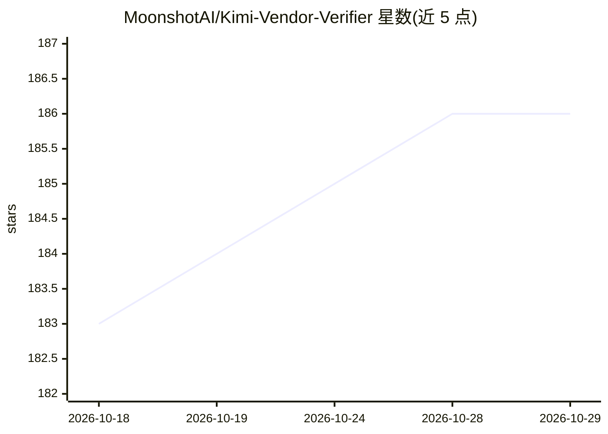

# MoonshotAI/Kimi-Vendor-Verifier

⭐ 186 · Python · MIT · 推送 2026-09-17 · [GitHub](https://github.com/MoonshotAI/Kimi-Vendor-Verifier) · 组织维护 · 中文 README

**为 Kimi 模型的各供应商 API 部署做验收评测的基准套件**

MoonshotAI 维护的评测与预检验证工具集，用于核验第三方供应商（Fireworks、Baseten、Together 等）对 Kimi 模型（当前 kimi-k3）API 部署的正确性。包含四部分：基于 Inspect-ai 的 OCRBench/MMMU 基准、BEAM 百万 token 长记忆基准、基于 Pier 平台的 DeepSWE 113 任务 agent 基准，以及若干 pytest 预检（API 参数约束、工具调用 JSON Schema、K3 特性契约、prompt_tokens 上报准确性）。通过 uv 安装并配置 KIMI_API_KEY/KIMI_BASE_URL 运行，须先通过全部预检再跑正式基准；支持 Kimi 官方 API 与 vLLM/SGLang 等开源部署两种思考参数格式。

## 筛选速览

| 维度 | 判定 | 备注 |
|---|---|---|
| AI 角色 | `ai-ecosystem` | LLM/agent 周边工具 |
| 许可风险 | `permissive` | MIT |
| 部署形态 | `library` | 以包/库形式分发 |
| 模型依赖 | local-ok | 支持本地模型 |
| 硬件要求 | — | 无带数字的原话,不猜 |
| 安装摩擦 | `low` | 无编译、无系统依赖或容器化 |
| 成熟度 | — | 结构信号不足 |

## 能力要点

- 四组 pytest 预检覆盖参数约束、工具调用 Schema、K3 特性与 prompt_tokens 核验
- Inspect-ai 基准（OCRBench/MMMU Pro Vision，K3 弃用 AIME 2025 并加入 reasoning_effort）
- BEAM 1M token 长记忆基准与 Pier 平台上的 DeepSWE 113 任务 agent 基准
- 区分 kimi 与 opensource（vLLM/SGLang/KTransformers）两种思考模式参数格式

## 适用场景

- 第三方供应商上线 Kimi 模型后做部署验收与一致性核验
- 核验供应商上报的 usage.prompt_tokens 与预期常量是否一致
- 按推荐参数复跑 OCRBench/MMMU/DeepSWE 基准对齐官方结果

## 场景标签

`模型评测` · 领域:评测与运维

## 证据(README 行号)

> L13: |Provider|OCRBench|MMMU Pro Vision|BEAM (1M)|DeepSWE|
> L33: |Pytest verifier|`tests/params/`|API parameter constraint pre-flight validation|
> L58: Before running benchmarks, complete the API parameter, tool-call schema, K3 feature, and prompt-token pre-flight ch

## 星数曲线

2026-10-18 183 → 2026-10-29 186（+3）

---
*卡片 v1 · prompt 1.4 · 生成 2026-10-22 · 置信度 high · 依据 README sha `f52a36d51a89` · [字段定义](../../DATASET.md)*
