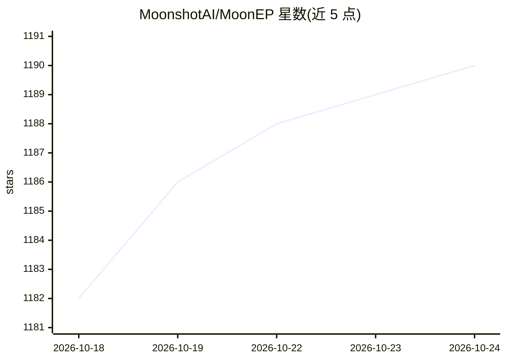

# MoonshotAI/MoonEP

⭐ 1,190 · Python · MIT · 推送 2026-10-12 · [GitHub](https://github.com/MoonshotAI/MoonEP) · 组织维护

**MoE 专家并行通信库：通过动态冗余专家保持 token 负载均衡**

面向 MoE 训练/推理框架开发者的专家并行（EP）通信库。核心机制：每个 rank 固定处理 S×K 个 token，由 GPU 规划内核在线从路由输出挑选少量冗余专家并在专家计算前预取权重，反向传播时把冗余专家梯度归约回宿主 rank；采用零拷贝与静态形状，消除逐层 host 同步。提供 Python Buffer API（dispatch/combine/prefetch_weight/reduce_grad），需 NVIDIA GPU 与 NVLink 多卡环境，pip install -e . 源码构建并运行测试。

## 筛选速览

| 维度 | 判定 | 备注 |
|---|---|---|
| AI 角色 | `ai-ecosystem` | LLM/agent 周边工具 |
| 许可风险 | `permissive` | MIT |
| 部署形态 | `library` | 以包/库形式分发 |
| 模型依赖 | — | README 未给出锁定关系 |
| 硬件要求 | — | 无带数字的原话,不猜 |
| 安装摩擦 | `medium` | 含编译或系统依赖之一 |
| 成熟度 | — | 结构信号不足 |

## 能力要点

- 每 rank 恒定处理 S×K token，任意路由倾斜下负载均衡
- 在线 GPU 规划内核 + 冗余专家权重预取与梯度归约
- 零拷贝与静态形状，消除逐层 MoE host 同步与内存碎片
- 提供 dispatch/combine/prefetch_weight/reduce_grad 的 Python API，支持异步执行

## 适用场景

- 为 MoE 训练框架集成负载均衡的专家并行通信
- 在路由高度倾斜场景下避免 OOM 与迭代时间退化
- 对比/替换现有 EP 通信方案（如 DeepEP）做基准测试

## 场景标签

`模型训练` · 领域:训练与推理

## 证据(README 行号)

> L3: MoonEP is an Expert Parallelism communication library that keeps token loads perfectly balanced across ranks via dyn
> L7: 1. **Perfect balance**: every rank receives exactly `S × K` tokens, no matter how skewed the routing is. A small num

## 星数曲线

2026-10-18 1,182 → 2026-10-24 1,190（+8）

---
*卡片 v1 · prompt 1.4 · 生成 2026-10-21 · 置信度 high · 依据 README sha `fd743e12d582` · [字段定义](../../DATASET.md)*
