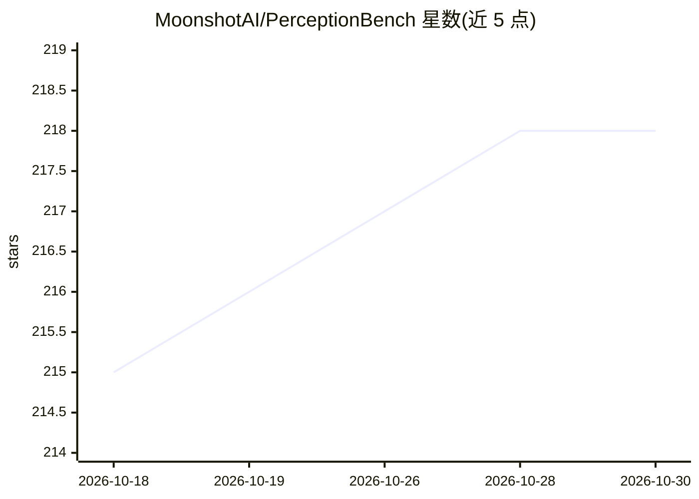

# MoonshotAI/PerceptionBench

⭐ 218 · Python · Apache-2.0 · 推送 2026-08-03 · [GitHub](https://github.com/MoonshotAI/PerceptionBench) · 组织维护 · 中文 README

**评测多模态大模型原子视觉感知能力的基准（3,000 题）**

面向 MLLM 视觉感知能力评测的基准数据集与评测脚本：从 42 个既有基准的失败点归纳出十种原子感知能力，构建 3,000 道短答案验证题，难度源于感知而非推理或知识。评测时通过 OpenAI 兼容端点向被测模型发送图文问题，再由 LLM 裁判模型对照参考答案给出 0/1 判定，输出逐题预测与总体/分能力准确率。已发布 16 个前沿 MLLM 的排行榜。

## 筛选速览

| 维度 | 判定 | 备注 |
|---|---|---|
| AI 角色 | `ai-ecosystem` | LLM/agent 周边工具 |
| 许可风险 | `permissive` | Apache-2.0 |
| 部署形态 | `library` | 以包/库形式分发 |
| 模型依赖 | — | README 未给出锁定关系 |
| 硬件要求 | — | 无带数字的原话,不猜 |
| 安装摩擦 | `low` | 无编译、无系统依赖或容器化 |
| 成熟度 | — | 结构信号不足 |

## 能力要点

- 十种原子感知能力、3,000 道短答案验证题
- LLM 裁判模型评分（人工一致性 99.7%）
- 兼容任意 OpenAI 兼容端点评测自有模型
- 16 个前沿 MLLM 排行榜

## 适用场景

- 评测自家多模态模型在各原子感知能力上的准确率
- 诊断模型感知相关幻觉等薄弱能力
- 对比不同 MLLM 的能力剖面

## 场景标签

`模型评测` `多模态` · 领域:评测与运维

## 证据(README 行号)

> L3: **PerceptionBench: Evaluating Atomic Visual Perception in Multimodal Large Language Models**
> L9: We introduce PerceptionBench, a benchmark specifically designed to evaluate the atomic visual perception capabilitie
> L75: python eval/eval.py

## 星数曲线

2026-10-18 215 → 2026-10-30 218（+3）

---
*卡片 v1 · prompt 1.4 · 生成 2026-10-22 · 置信度 mid · 依据 README sha `6b1c42a68738` · [字段定义](../../DATASET.md)*
