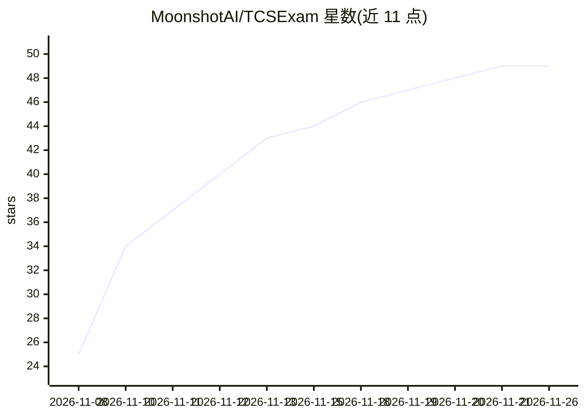

# MoonshotAI/TCSExam

⭐ 49 · Python · Apache-2.0 · 推送 2026-11-12 · [GitHub](https://github.com/MoonshotAI/TCSExam) · [官网](https://moonshotai.github.io/TCSExam/) · 组织维护 · 中文 README

**评测模型–智能体系统在理论计算机科学研究任务上的基准**

MoonshotAI 维护的理论计算机科学（TCS）研究基准：包含 100 个可验证任务（Full 套件），Lite 套件从中选 20 个，覆盖定理证明（Lean 证明）、求解器工程（隐藏实例上评估算法实现）、构造与公开猜想四类；Solver 任务提供 Online/Offline 两种协议。运行需 Linux x86-64、Python 3.12+、Docker Compose 与 Buildx，通过安装 Harbor 0.22.0 运行智能体并收集输出；默认使用 Kimi Code，也支持 Claude Code、Codex 与 Grok Build。评分按四赛道加权合成 TCSExam Index。

## 筛选速览

| 维度 | 判定 | 备注 |
|---|---|---|
| AI 角色 | `ai-ecosystem` | LLM/agent 周边工具 |
| 许可风险 | `permissive` | Apache-2.0 |
| 部署形态 | `None` |  |
| 模型依赖 | locked-api |  |
| 硬件要求 | — | 无带数字的原话,不猜 |
| 安装摩擦 | `low` | 无编译、无系统依赖或容器化 |
| 成熟度 | — | 结构信号不足 |

## 能力要点

- 100 个任务分四类：Lean 定理证明、求解器工程、构造、公开猜想
- Solver 任务提供 Online（评测反馈）与 Offline（公开自测+隐藏评测）两种协议
- 默认 Kimi Code，同时支持 Claude Code、Codex、Grok Build
- 四赛道加权计算 TCSExam Index，Construction 分可超 1 使指数可超 100

## 适用场景

- 评测前沿 LLM 在理论计算机科学研究任务上的能力
- 研究者在模型开发过程中获取评测反馈并比较结果
- 复现与检验基准论文报告的分数

## 场景标签

`模型评测` · 领域:评测与运维

## 证据(README 行号)

> L10: TCSExam evaluates model–agent systems on verifiable theoretical computer science research tasks.
> L51: actual result files. It uses Kimi Code by default. Claude Code, Codex and Grok

## 星数曲线

2026-11-08 25 → 2026-11-26 49（+24）

---
*卡片 v1 · prompt 1.4 · 生成 2026-11-18 · 置信度 high · 依据 README sha `51c73af7cd3a` · [字段定义](../../DATASET.md)*
