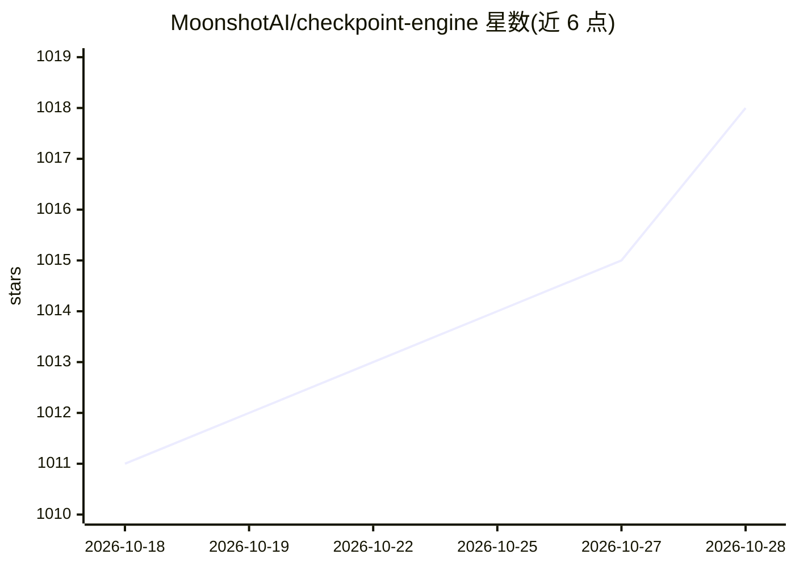

# MoonshotAI/checkpoint-engine

⭐ 1,018 · Python · MIT · 推送 2026-10-22 · [GitHub](https://github.com/MoonshotAI/checkpoint-engine) · 组织维护 · 中文 README

**LLM 推理引擎的模型权重热更新中间件，面向强化学习场景**

由 MoonshotAI 维护的权重更新中间件：核心为与推理引擎同置部署的 ParameterServer 服务，通过 Broadcast 与 P2P 两种方式原地更新模型权重，Broadcast 路径将 H2D、广播、reload 三阶段组织成流水线并通过 ZeroMQ 控制推理引擎；P2P 路径借助 mooncake-transfer-engine 在 RDMA 上向新增实例传权重。官方基准显示 Kimi-K2（FP8）在 256 张 H20 上广播更新约 16 秒。当前测试覆盖 vLLM 与 SGLang，支持 CUDA 与 Intel XPU（XPU 仅 Broadcast，需源码安装），FP8 需 vLLM 补丁。

## 筛选速览

| 维度 | 判定 | 备注 |
|---|---|---|
| AI 角色 | `ai-ecosystem` | LLM/agent 周边工具 |
| 许可风险 | `permissive` | MIT |
| 部署形态 | `library` | 以包/库形式分发 |
| 模型依赖 | local-ok | 支持本地模型 |
| 硬件要求 | — | 无带数字的原话,不猜 |
| 安装摩擦 | `medium` | 含编译或系统依赖之一 |
| 成熟度 | — | 结构信号不足 |

## 能力要点

- Broadcast 与 P2P 两种原地权重更新实现
- 三阶段流水线传输，显存不足时回退串行执行
- P2P 路径基于 mooncake-transfer-engine 的 RDMA 传输
- 提供 vLLM 与 SGLang 集成及 FP8 补丁

## 适用场景

- 强化学习训练中向大规模推理集群热更新模型权重
- 推理实例动态扩容时从现有实例复用权重
- 大规模分布式检查点快速加载以缩短模型加载时间

## 场景标签

`强化学习` · 领域:训练与推理

## 证据(README 行号)

> L2: Checkpoint-engine is a simple middleware to update model weights in LLM inference engines -- a critical step in rein
> L10: The core weight update logic is in `ParameterServer` class, a service colocated with inference engines. It provides
> L219: - This project is currently tested with vLLM and SGLang. Integration with other frameworks is planned for future r

## 星数曲线

2026-10-18 1,011 → 2026-10-28 1,018（+7）

---
*卡片 v1 · prompt 1.4 · 生成 2026-10-21 · 置信度 high · 依据 README sha `a4dc05bdb74d` · [字段定义](../../DATASET.md)*
