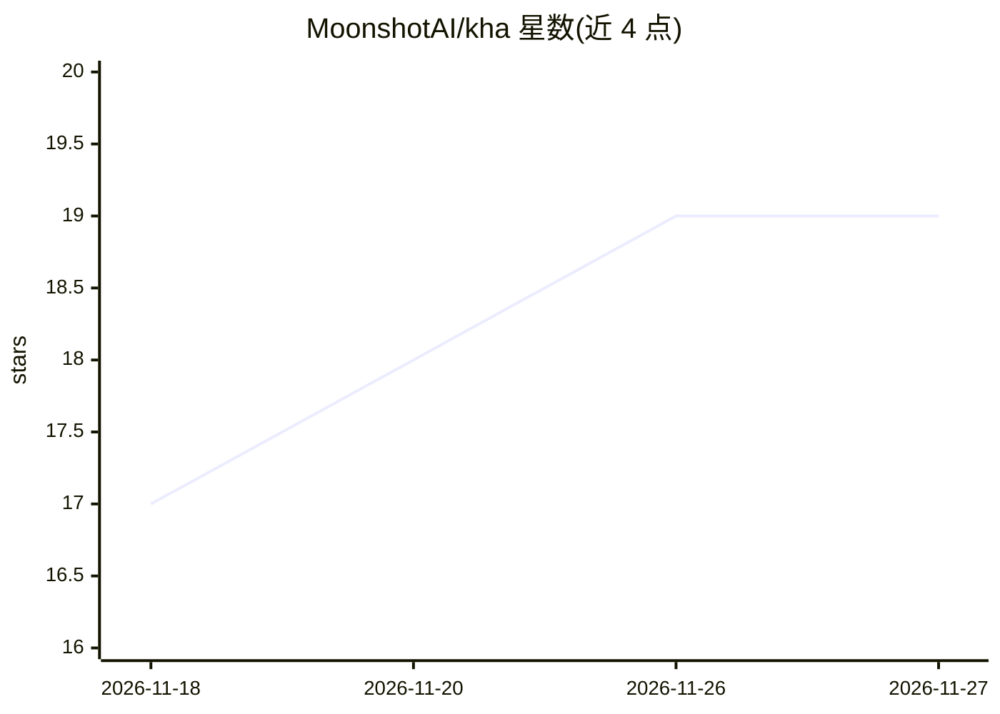

# MoonshotAI/kha

⭐ 19 · Go · NOASSERTION · 推送 2026-11-23 · [GitHub](https://github.com/MoonshotAI/kha) · 组织维护 · 中文 README

**Kimi Hosted Agents 的官方 Go SDK 与 CLI 客户端**

MoonshotAI 官方出品的 Go SDK 和命令行工具，用于接入 Kimi Hosted Agents 托管平台——在云端沙箱中运行长时异步 AI agent 任务。SDK 从 OpenAPI 契约生成强类型模型，提供分页迭代器、SSE 流断线恢复、资源等待器、幂等重试与 webhook 签名校验；CLI 支持表格/JSON/YAML 输出、GJSON 字段提取、实时事件流与终端交互。注意它是托管平台的客户端而非本地 agent 运行时，模型推理与会话状态均在云端执行。

## 筛选速览

| 维度 | 判定 | 备注 |
|---|---|---|
| AI 角色 | `ai-ecosystem` | LLM/agent 周边工具 |
| 许可风险 | `none` | NOASSERTION |
| 部署形态 | `library` | 以包/库形式分发 |
| 模型依赖 | — | README 未给出锁定关系 |
| 硬件要求 | — | 无带数字的原话,不猜 |
| 安装摩擦 | `low` | 无编译、无系统依赖或容器化 |
| 成熟度 | — | 结构信号不足 |

## 能力要点

- 零依赖 Go SDK：强类型生成模型、SSE 流恢复、幂等重试、webhook 签名校验
- CLI 提供实时事件流 attach、GJSON --transform 提取、终端对话输入
- RunTools 自定义工具执行：事件 ID 幂等键保证不重复应答
- 跨平台预编译 CLI 二进制（macOS/Linux/Windows amd64/arm64）

## 适用场景

- 在 Go 应用中编程管理云端 agent 的 Session、任务与事件流
- 从终端创建会话、发送任务并实时查看 agent 输出
- 为云端 agent 注册并执行本地自定义工具

## 场景标签

`Agent 框架` · 领域:Agent 开发

## 证据(README 行号)

> L13: **KHA** is the official Go SDK and command-line client for Kimi Hosted Agents, a managed platform for running long-
> L17: - **Zero-dependency Go SDK** (`github.com/MoonshotAI/kha`): Strongly typed models and resource clients generated fr
> L29: > **Note:** KHA is a client for the hosted platform, not a local agent runtime. Model inference, sandbox execution,

## 星数曲线

2026-11-18 17 → 2026-11-27 19（+2）

---
*卡片 v1 · prompt 1.4 · 生成 2026-11-18 · 置信度 high · 依据 README sha `c7b423510983` · [字段定义](../../DATASET.md)*
