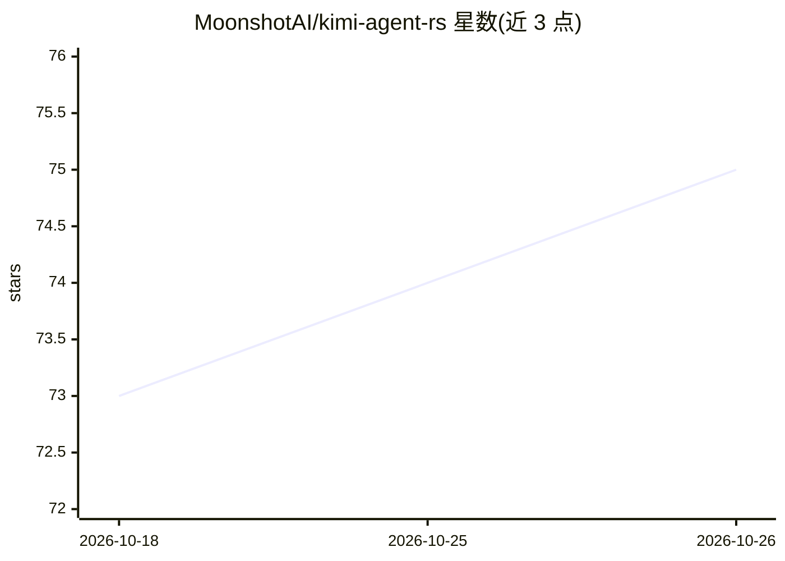

# MoonshotAI/kimi-agent-rs

⭐ 75 · Rust · Apache-2.0 · 推送 2026-02-06 · [GitHub](https://github.com/MoonshotAI/kimi-agent-rs) · 组织维护

**Kimi Code CLI 的 Rust 实现：基于 JSON-RPC 的 wire-only agent 服务器**

MoonshotAI 维护的 Rust 工作区，实现 Kimi Code CLI 的 Wire 模式兼容 agent 服务器，通过 stdio 提供 JSON-RPC 接口。包含三个 crate：kimi-agent（主二进制，含 wire 服务器、工具、agent 循环、MCP）、kosong（LLM 抽象层，覆盖消息、工具 schema 与 providers）、kaos（OS 抽象层）。本项目是 Python kimi-cli 的重写，Python 仓库作为 git submodule 引入并被声明为事实源，两者需在 wire 协议、消息格式、~/.kimi 数据布局与工具 schema 上保持兼容，版本号须与 kimi-cli 一致。通过 cargo 构建运行，Apache-2.0 许可。

## 筛选速览

| 维度 | 判定 | 备注 |
|---|---|---|
| AI 角色 | `ai-ecosystem` | LLM/agent 周边工具 |
| 许可风险 | `permissive` | Apache-2.0 |
| 部署形态 | `None` |  |
| 模型依赖 | — | README 未给出锁定关系 |
| 硬件要求 | — | 无带数字的原话,不猜 |
| 安装摩擦 | `low` | 无编译、无系统依赖或容器化 |
| 成熟度 | — | 结构信号不足 |

## 能力要点

- stdio 上的 wire-only JSON-RPC agent 服务器
- kosong LLM 抽象层：消息、工具 schema、多 provider
- 支持 MCP（Model Context Protocol）
- 与 Python kimi-cli 在 wire 协议与数据布局上保持兼容

## 适用场景

- 为需要 Kimi Code CLI Wire 模式的客户端提供 agent 服务端
- 以 Rust 运行时替换 Python kimi-cli 并保持协议兼容
- 基于 kosong/kaos 抽象层扩展 LLM provider 或 OS 适配

## 场景标签

`编码 Agent` · 领域:编码与开发

## 证据(README 行号)

> L3: Rust implementation of Kimi Code CLI. Wire-only JSON-RPC agent server over stdio.
> L25: |`kimi-agent`|Main binary — wire server, tools, agent loop, MCP|
> L26: |`kosong`|LLM abstraction — messages, tool schemas, providers|

## 星数曲线

2026-10-18 73 → 2026-10-26 75（+2）

---
*卡片 v1 · prompt 1.4 · 生成 2026-10-24 · 置信度 high · 依据 README sha `09ccabe33e0b` · [字段定义](../../DATASET.md)*
