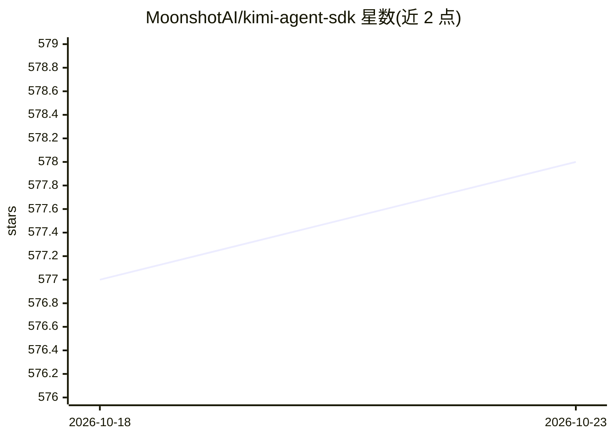

# MoonshotAI/kimi-agent-sdk

⭐ 578 · TypeScript · Apache-2.0 · 推送 2026-05-29 · [GitHub](https://github.com/MoonshotAI/kimi-agent-sdk) · 组织维护

**在应用中接入 Kimi CLI agent 运行时的多语言 SDK**

MoonshotAI 提供的 Go/Node.js/Python 三语言 SDK，将 Kimi Code（Kimi CLI）agent 运行时以编程接口暴露给应用：复用 CLI 的配置、工具、技能与 MCP 服务器，实时流式返回响应，支持注册自定义工具、编排多轮会话、程序化处理权限审批。以 CLI 为执行引擎，用于构建产品、自动化任务与定制工具。三个语言包均已发布，附快速入门与示例工程。

## 筛选速览

| 维度 | 判定 | 备注 |
|---|---|---|
| AI 角色 | `ai-ecosystem` | LLM/agent 周边工具 |
| 许可风险 | `permissive` | Apache-2.0 |
| 部署形态 | `library` | 以包/库形式分发 |
| 模型依赖 | — | README 未给出锁定关系 |
| 硬件要求 | — | 无带数字的原话,不猜 |
| 安装摩擦 | `low` | 无编译、无系统依赖或容器化 |
| 成熟度 | — | 结构信号不足 |

## 能力要点

- Go/Node.js/Python 三语言 SDK，均已可用
- 复用 Kimi CLI 的配置、工具、技能与 MCP 服务器
- 实时流式响应，暴露审批与工具调用事件
- 支持注册自定义工具与程序化处理权限请求

## 适用场景

- 在自己的应用中集成 Kimi agent 能力
- 脚本化编排多轮对话与自动化任务
- 为模型注册自定义可调用工具

## 场景标签

`Agent 框架` · 领域:Agent 开发

## 证据(README 行号)

> L9: Kimi Agent SDK is a set of multi-language libraries that expose the Kimi Code (Kimi CLI) agent runtime in your appli
> L11: The SDKs are thin, language-native clients that reuse the same Kimi CLI configuration, tools, skills, and MCP serve

## 星数曲线

2026-10-18 577 → 2026-10-23 578（+1）

---
*卡片 v1 · prompt 1.4 · 生成 2026-10-21 · 置信度 high · 依据 README sha `1e2705392a8f` · [字段定义](../../DATASET.md)*
