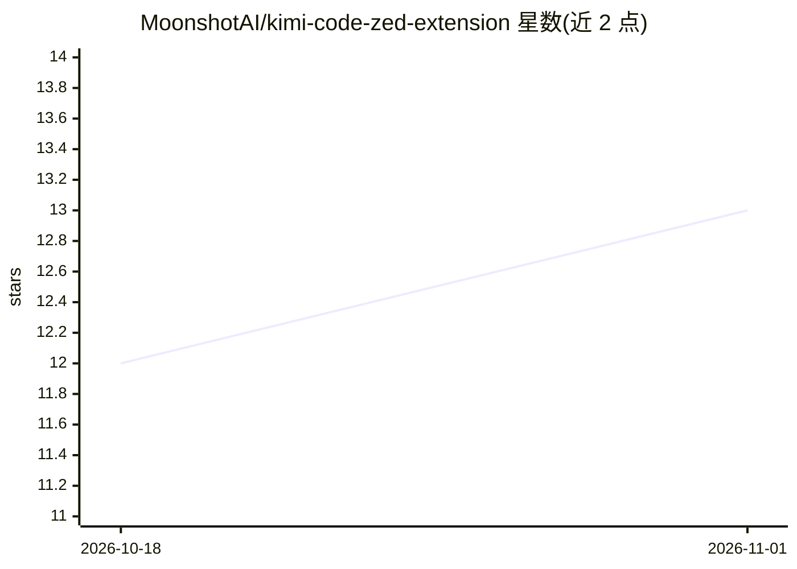

# MoonshotAI/kimi-code-zed-extension

⭐ 13 · Apache-2.0 · 推送 2026-01-20 · [GitHub](https://github.com/MoonshotAI/kimi-code-zed-extension) · 组织维护 · 中文 README

**将 Kimi CLI 以 ACP agent 形式集成进 Zed 编辑器的扩展**

由 MoonshotAI 维护的 Zed 编辑器扩展：把 Kimi CLI 接入 Zed 作为 ACP（Agent Communication Protocol）agent，用户在 agent 面板中开启会话，通过终端交互式认证，选择 LLM 提供商（Kimi、OpenAI、Anthropic 等）并填入 API key 后即可使用。支持 @ 引用文件/符号/网页内容作为上下文、执行 shell 命令、编辑代码及调用 MCP 工具与技能。覆盖 macOS（Apple Silicon/Intel）、Linux x86_64、Windows x86_64，自动下载并配置 CLI 二进制。

## 筛选速览

| 维度 | 判定 | 备注 |
|---|---|---|
| AI 角色 | `ai-ecosystem` | LLM/agent 周边工具 |
| 许可风险 | `permissive` | Apache-2.0 |
| 部署形态 | `None` |  |
| 模型依赖 | — | README 未给出锁定关系 |
| 硬件要求 | — | 无带数字的原话,不猜 |
| 安装摩擦 | `low` | 无编译、无系统依赖或容器化 |
| 成熟度 | — | 结构信号不足 |

## 能力要点

- 将 Kimi CLI 以 ACP agent 集成到 Zed 编辑器
- 首次使用通过终端交互式认证，支持多家 LLM 提供商选择
- 支持 @ 引用文件/符号/网页上下文、shell 命令执行与 MCP 工具
- 跨平台（macOS/Linux/Windows）且自动下载二进制

## 适用场景

- 在 Zed 编辑器内直接用 Kimi CLI 完成开发任务
- 通过 @ 文件、符号引用给 agent 提供代码上下文
- 在编辑器中运行带 MCP 工具的终端型编程 agent

## 场景标签

`编码 Agent` · 领域:编码与开发

## 证据(README 行号)

> L3: A Zed extension that integrates Kimi CLI as an ACP (Agent Communication Protocol) agent.
> L33: - Use Kimi CLI to complete software development tasks

## 星数曲线

2026-10-18 12 → 2026-11-01 13（+1）

---
*卡片 v1 · prompt 1.4 · 生成 2026-10-31 · 置信度 high · 依据 README sha `28b3bd23d0ec` · [字段定义](../../DATASET.md)*
