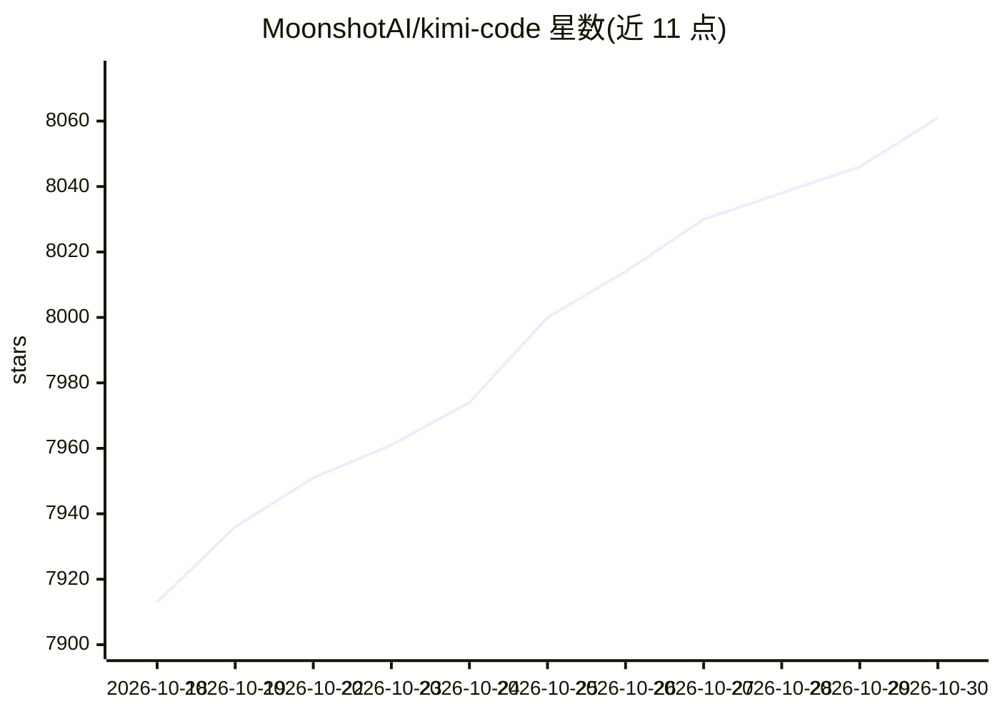

# MoonshotAI/kimi-code

⭐ 8,061 · TypeScript · MIT · 推送 2026-10-29 · [GitHub](https://github.com/MoonshotAI/kimi-code) · [官网](https://www.kimi.com/code/docs/) · 组织维护 · 中文 README

**终端 AI 编程代理：读写代码、执行命令、自主选择下一步**

MoonshotAI 出品的命令行 AI 编程代理，可读取和编辑代码、运行 shell 命令、搜索文件、抓取网页并根据反馈决定下一步操作。开箱即用接入 Kimi 系列模型，也可配置其他兼容 provider；登录支持 Kimi Code OAuth 或开放平台 API key。提供单二进制安装脚本（无需 Node.js）、TUI 交互界面、视频输入、MCP 配置、插件市场、coder/explore/plan 子代理、生命周期钩子，并可通过 Agent Client Protocol 接入 Zed、JetBrains 等编辑器。MIT 许可，开发需 Node.js ≥24 与 pnpm。

## 筛选速览

| 维度 | 判定 | 备注 |
|---|---|---|
| AI 角色 | `ai-native` | 本体是模型或模型工具 |
| 许可风险 | `permissive` | MIT |
| 部署形态 | `desktop` | 安装包/桌面程序 |
| 模型依赖 | — | README 未给出锁定关系 |
| 硬件要求 | — | 无带数字的原话,不猜 |
| 安装摩擦 | `low` | 无编译、无系统依赖或容器化 |
| 成熟度 | — | 结构信号不足 |

## 能力要点

- 单二进制分发，安装脚本无需 Node.js 环境
- 支持视频输入（录屏/演示片段）作为任务素材
- 内置 coder/explore/plan 子代理并行工作与生命周期钩子
- 通过 ACP 协议接入 Zed/JetBrains 等 IDE，支持 MCP 与插件市场

## 适用场景

- 在终端里让 AI 代理阅读、修改项目代码并执行命令
- 把录屏或演示视频转成代码、LUT 等产出
- 在 Zed/JetBrains 编辑器中驱动同一 CLI 会话

## 场景标签

`编码 Agent` · 领域:编码与开发

## 证据(README 行号)

> L10: Kimi Code CLI is an AI coding agent that runs in your terminal — it can read and edit code, run shell commands, sea
> L47: On first launch, run `/login` inside Kimi Code CLI and choose either Kimi Code OAuth or a Moonshot AI Open Platform

## 星数曲线

2026-10-18 7,913 → 2026-10-30 8,061（+148）

---
*卡片 v1 · prompt 1.4 · 生成 2026-10-20 · 置信度 mid · 依据 README sha `c7ff4156a27a` · [字段定义](../../DATASET.md)*
