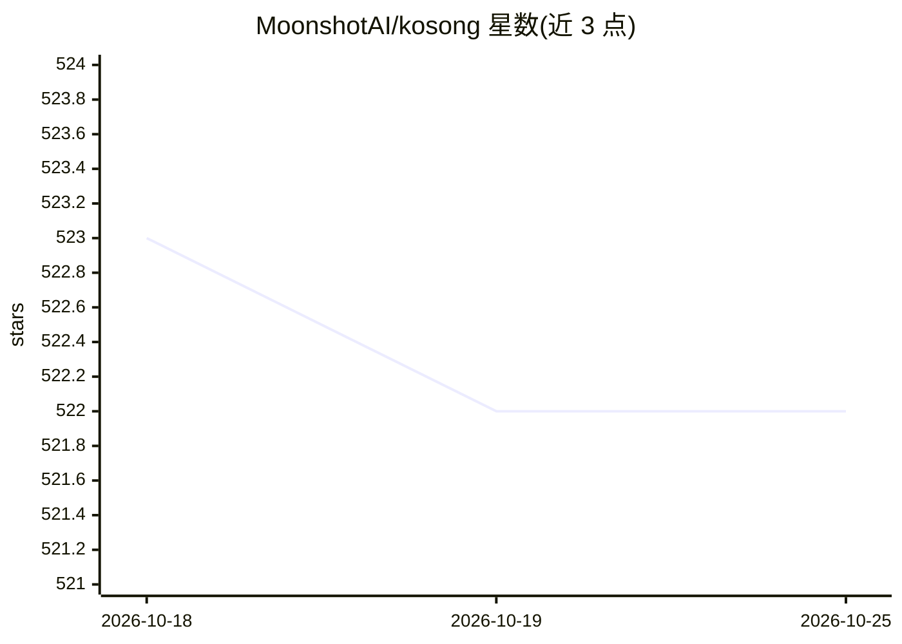

# MoonshotAI/kosong

⭐ 522 · 推送 2026-07-16 · [GitHub](https://github.com/MoonshotAI/kosong) · [官网](https://moonshotai.github.io/kosong/) · 组织维护 · 中文 README

**面向 AI agent 应用的 LLM 抽象层（已迁移至 kimi-cli monorepo）**

MoonshotAI 开发的 LLM 抽象层包，用于 agent 应用统一接入 LLM。README 仅声明本包开发已迁移至 kimi-cli monorepo 的 packages/kosong 目录，并给出新地址链接，未提供功能、安装或使用说明。该仓库当前作为迁移公告存在。

## 筛选速览

| 维度 | 判定 | 备注 |
|---|---|---|
| AI 角色 | `ai-ecosystem` | LLM/agent 周边工具 |
| 许可风险 | `none` | — |
| 部署形态 | `None` |  |
| 模型依赖 | — | README 未给出锁定关系 |
| 硬件要求 | — | 无带数字的原话,不猜 |
| 安装摩擦 | `low` | 无编译、无系统依赖或容器化 |
| 成熟度 | — | 结构信号不足 |

## 能力要点

- 定位为面向 agent 应用的 LLM 抽象层
- 开发已迁移至 MoonshotAI/kimi-cli monorepo
- README 仅含迁移指引，无安装与使用文档

## 适用场景

- 原使用者需迁移至 kimi-cli monorepo 继续使用
- 通过新 monorepo 了解该抽象层的现状

## 场景标签

`模型网关` · 领域:Agent 开发

## 证据(README 行号)

> L3: The development of this package has moved to the kimi-cli monorepo:

## 星数曲线

2026-10-18 523 → 2026-10-25 522（-1）

---
*卡片 v1 · prompt 1.4 · 生成 2026-10-21 · 置信度 low · 依据 README sha `f181fc40224e` · [字段定义](../../DATASET.md)*
