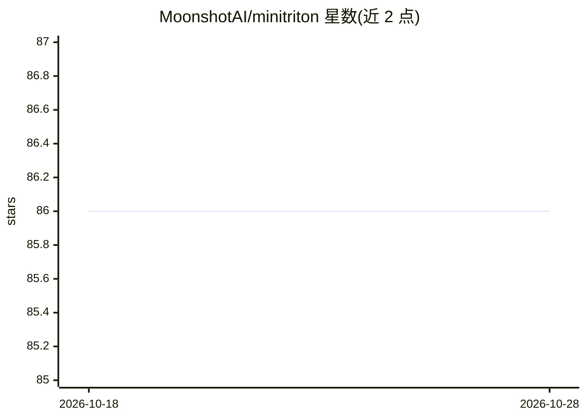

# MoonshotAI/minitriton

⭐ 86 · Python · Apache-2.0 · 推送 2026-07-27 · [GitHub](https://github.com/MoonshotAI/minitriton) · 组织维护 · 中文 README

**面向教学的 GPU tile 编译器与 eager 张量库（Python DSL→MLIR→PTX）**

由 Moonshot AI 的 K3 模型设计实现的 tile 编译器演示项目：用户以 Python 内嵌的 tile DSL 编写 GPU kernel，经上游 MLIR 方言 lowering 到 PTX，在 NVIDIA GPU 上运行；上层提供 eager 执行的张量库（tensor/nn/autograd 同一 API），flash attention、KDA 等应用 kernel 均用 DSL 本身写成。配套 NCCL 数据并行、roofline/训练基准与可视化示例。定位为教学级、非生产用途（官方声明），仅在 L20 (sm_89) 验证，无 AMD/ROCm，算子覆盖与 autograd 存在已文档化的限制。torch/triton 仅作对比基线，非运行时依赖。

## 筛选速览

| 维度 | 判定 | 备注 |
|---|---|---|
| AI 角色 | `ai-ecosystem` | LLM/agent 周边工具 |
| 许可风险 | `permissive` | Apache-2.0 |
| 部署形态 | `library` | 以包/库形式分发 |
| 模型依赖 | — | README 未给出锁定关系 |
| 硬件要求 | — | 无带数字的原话,不猜 |
| 安装摩擦 | `medium` | 含编译或系统依赖之一 |
| 成熟度 | `idea` | |

## 能力要点

- Python tile DSL 经 MLIR 降到 PTX，应用 kernel（flash attention/KDA）全部用 DSL 编写
- eager 张量库与 tile 级编译共用一套 API（tensor/nn/autograd）
- roofline/训练基准脚本可复现，与 torch、torch.compile、triton 基线对比
- NCCL 数据并行（2 GPU 单节点测试）与图形/物理示例（SPH/MPM 等）

## 适用场景

- 学习 tile 编译器与 MLIR lowering 的实现结构
- 研究 GPU kernel 编写模型（对照 Triton 编程模型）
- 运行小规模 GPT 训练与 kernel 基准实验

## 场景标签

`教程课程` · 领域:学习与行业

## 证据(README 行号)

> L3: MiniTriton is a teaching-grade but production-minded tile compiler. You
> L5: upstream MLIR dialects to PTX and run on NVIDIA GPUs. On top of that sits
> L25: > **Disclaimer: this is a demonstration of K3's capability on compiler

## 星数曲线

2026-10-18 86 → 2026-10-28 86（+0）

---
*卡片 v1 · prompt 1.4 · 生成 2026-10-24 · 置信度 high · 依据 README sha `29cd5206600f` · [字段定义](../../DATASET.md)*
