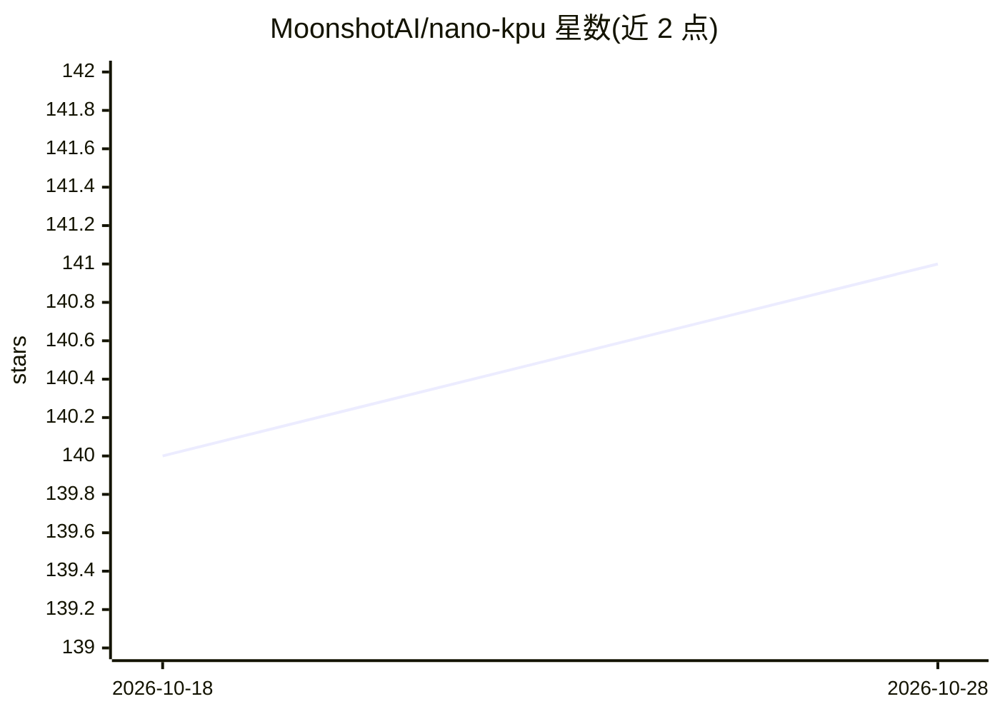

# MoonshotAI/nano-kpu

⭐ 141 · Verilog · Apache-2.0 · 推送 2026-07-23 · [GitHub](https://github.com/MoonshotAI/nano-kpu) · 组织维护 · 中文 README

**由 Kimi-K3 设计的纳米级混合架构推理芯片 RTL 及仿真测试流程**

由 Kimi-K3 完整设计并实现的纳米级混合架构推理芯片 RTL 代码仓库，附带功能仿真与时序/面积测试流程。模型架构为混合注意力 MoE transformer：KDA 线性注意力、NoPE 多头潜在注意力、sigmoid 路由 MoE、注意力残差混合，采用 int4 group-128 权重。使用 Verilator 5 与 yosys 的开源工具链，基于 Nangate45 单元库做综合阶段（非布局布线后）的面积与时序测量，正确性以对 float32 参考的 logits 余弦相似度与 argmax 一致率衡量。声明为 Kimi K3 演示项目，非 Moonshot AI 官方项目。

## 筛选速览

| 维度 | 判定 | 备注 |
|---|---|---|
| AI 角色 | `ai-ecosystem` | LLM/agent 周边工具 |
| 许可风险 | `permissive` | Apache-2.0 |
| 部署形态 | `None` |  |
| 模型依赖 | — | README 未给出锁定关系 |
| 硬件要求 | — | 无带数字的原话,不猜 |
| 安装摩擦 | `low` | 无编译、无系统依赖或容器化 |
| 成熟度 | — | 结构信号不足 |

## 能力要点

- RTL 实现 KDA 线性注意力 + NoPE MLA + sigmoid 路由 MoE 混合架构
- int4 group-128 权重与逐 token 解码
- conda 中心化的一键环境搭建（Verilator 5.x / yosys / python3.12）
- bit-exact Python 定点模型用于仿真辅助，正确性以 cosine >= 0.98 衡量

## 适用场景

- 研究混合架构 transformer 的 RTL 硬件实现方式
- 复现开源 EDA 工具链下的功能仿真与综合测量流程
- 考察 AI 模型自动生成芯片设计的产出形态

## 场景标签

 · 领域:芯片设计/硬件加速

## 证据(README 行号)

> L3: This repo contains the RTL design of a nano-scale hybrid-architecture
> L4: inference chip, which was designed and implemented fully by Kimi-K3, plus its
> L6: hybrid-attention MoE transformer: **KDA (Kimi Delta Attention) linear
> L12: *Disclaimer: This is a demonstration of Kimi K3, not an official project by Moonshot AI.*

## 星数曲线

2026-10-18 140 → 2026-10-28 141（+1）

---
*卡片 v1 · prompt 1.4 · 生成 2026-10-23 · 置信度 high · 依据 README sha `77ed9fc8bd3d` · [字段定义](../../DATASET.md)*
