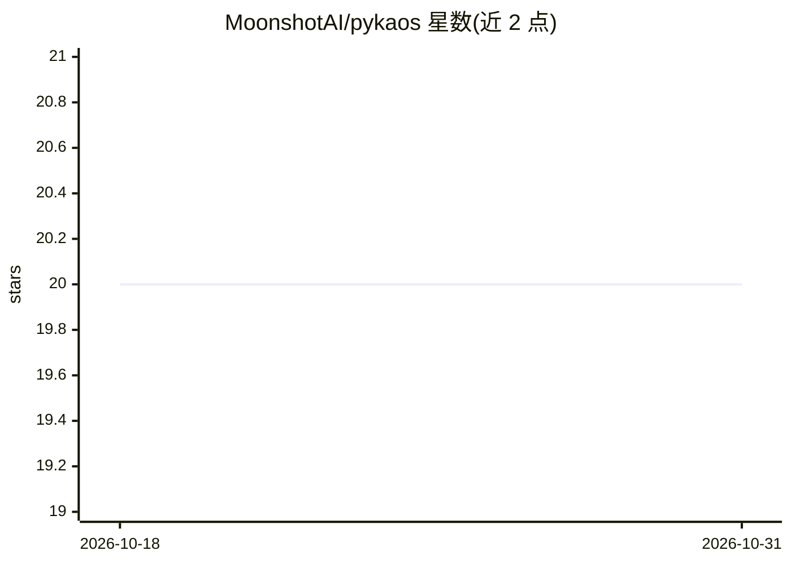

# MoonshotAI/pykaos

⭐ 20 · 推送 2025-12-26 · [GitHub](https://github.com/MoonshotAI/pykaos) · 组织维护

**面向 agent 的轻量操作系统抽象层（已迁移）**

MoonshotAI 开发的 PyKAOS：为 AI agent 提供轻量级的操作系统抽象层，主题标签含 filesystem、sandbox、llm。README 仅包含一条迁移公告：本包的开发已迁移至 kimi-cli 单仓库的 packages/kaos 目录，仓库内未提供安装命令、使用说明或功能细节。相关能力需到新地址查看。

## 筛选速览

| 维度 | 判定 | 备注 |
|---|---|---|
| AI 角色 | `ai-ecosystem` | LLM/agent 周边工具 |
| 许可风险 | `none` | — |
| 部署形态 | `None` |  |
| 模型依赖 | — | README 未给出锁定关系 |
| 硬件要求 | — | 无带数字的原话,不猜 |
| 安装摩擦 | `low` | 无编译、无系统依赖或容器化 |
| 成熟度 | — | 结构信号不足 |

## 能力要点

- 为 agent 提供文件系统/沙箱等 OS 抽象（据描述与主题标签）
- 开发已迁移至 MoonshotAI/kimi-cli monorepo 的 packages/kaos
- README 本体仅存迁移公告

## 适用场景

- 通过 kimi-cli monorepo 获取该 OS 抽象层的新版本
- 了解 agent 沙箱/文件系统抽象的动向

## 场景标签

 · 领域:LLM 基础设施/agent 工具

## 证据(README 行号)

> L1: # PyKAOS
> L3: The development of this package has moved to the kimi-cli monorepo:

## 星数曲线

2026-10-18 20 → 2026-10-31 20（+0）

---
*卡片 v1 · prompt 1.4 · 生成 2026-10-28 · 置信度 mid · 依据 README sha `0354c22cf2e4` · [字段定义](../../DATASET.md)*
