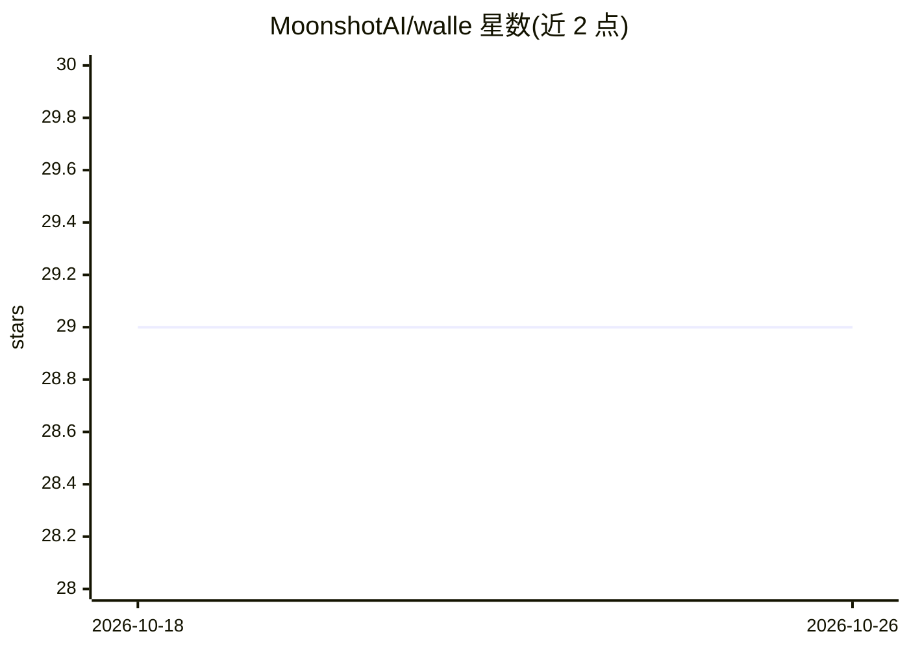

# MoonshotAI/walle

⭐ 29 · Go · MIT · 推送 2026-09-15 · [GitHub](https://github.com/MoonshotAI/walle) · 组织维护

**面向开发者：Moonshot AI 风格的 JSON Schema 校验库（Go/Python）**

由 Moonshot AI 维护的 JSON Schema 解析与校验库，Go 包以 walle.go 为入口提供 ParseSchema 与 Schema.Validate 两个 API，支持 ultra/default、strict、lite、loose 四档校验级别，其中 strict 为 Moonshot AI 服务器用于高效结构化生成的宽松级别。Python 侧以 walle 包发布，wheel 内嵌经 CGO 编译的 libwalle.so 共享库，附带工具调用 schema 转换/化简辅助函数（ms_tool_req_cvt / ms_tool_req_simplify）。限制：Python 绑定存在 fork/线程安全约束——建议 multiprocessing 用 spawn、仅主线程调用校验，跨进程不得复用 validator 实例。

## 筛选速览

| 维度 | 判定 | 备注 |
|---|---|---|
| AI 角色 | `ai-ecosystem` | LLM/agent 周边工具 |
| 许可风险 | `permissive` | MIT |
| 部署形态 | `library` | 以包/库形式分发 |
| 模型依赖 | — | README 未给出锁定关系 |
| 硬件要求 | — | 无带数字的原话,不猜 |
| 安装摩擦 | `low` | 无编译、无系统依赖或容器化 |
| 成熟度 | — | 结构信号不足 |

## 能力要点

- ParseSchema + Schema.Validate 两个核心 API，四档校验级别（ultra/strict/lite/loose）
- Go 库 / go install CLI / 内嵌 libwalle.so 的 Python wheel 三种形态
- 工具调用 schema 转换与化简辅助函数（ms_tool_req_cvt / ms_tool_req_simplify）
- 文档明确 Python + CGO 的 fork 与线程安全规则及回归测试

## 适用场景

- 在结构化生成流程中校验 JSON Schema（含 Moonshot AI strict 级别）
- 将工具调用请求转换为内部 schema 或化简并收集警告
- 在 Go 或 Python 服务中嵌入 schema 校验能力

## 场景标签

 · 领域:LLM 基础设施/结构化输出

## 证据(README 行号)

> L2: A Moonshot AI flavored Json schema validator.
> L10:  - **strict**: The most permissive level required by Moonshot AI server for efficient structured generation.

## 星数曲线

2026-10-18 29 → 2026-10-26 29（+0）

---
*卡片 v1 · prompt 1.4 · 生成 2026-10-26 · 置信度 high · 依据 README sha `0afa64a1c484` · [字段定义](../../DATASET.md)*
