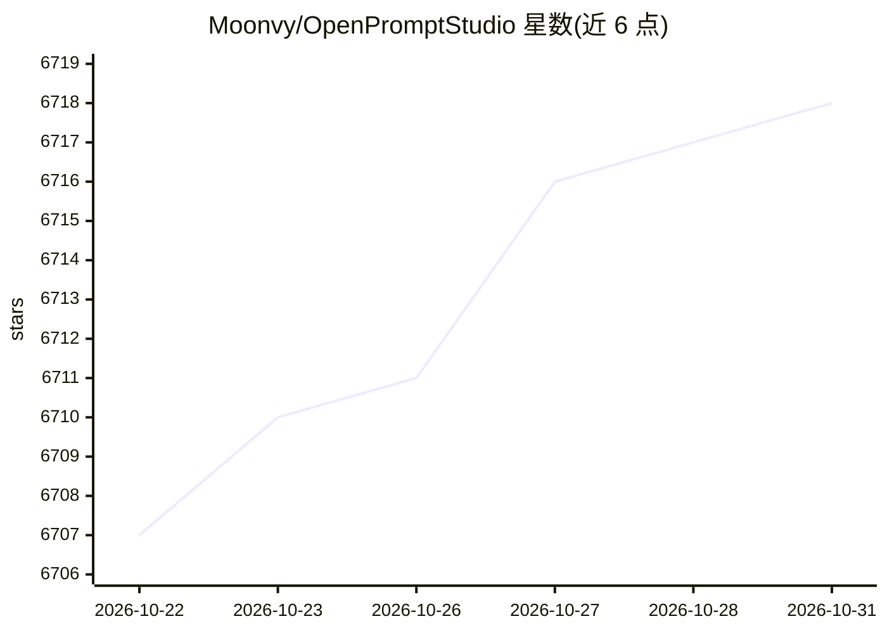

# Moonvy/OpenPromptStudio

⭐ 6,718 · Vue · 推送 2026-10-21 · [GitHub](https://github.com/Moonvy/OpenPromptStudio) · [官网](https://moonvy.com/apps/ops/) · 组织维护 · 中文 README

**面向 Midjourney 用户的 AIGC 提示词可视化编辑器**

Web 端提示词编辑工具：将英文提示词可视化并支持编辑，提供中英互译（输入中文译为英文以适配 Midjourney）、按普通/样式/质量/命令分类、排序与隐藏提示词、导出为图片、常用提示词词典等功能；词典可通过 Notion 数据库自定义管理（需自建 Notion 集成并配置 Token）。本地开发需 NodeJS 环境（npm run start）或 Docker 运行；翻译服务调用腾讯机器翻译 API，需申请账号并配置密钥，官方提供在线版可直接使用。

## 筛选速览

| 维度 | 判定 | 备注 |
|---|---|---|
| AI 角色 | `ai-enhanced` | 去掉 AI 部分产品仍成立 |
| 许可风险 | `none` | — |
| 部署形态 | `None` |  |
| 模型依赖 | — | README 未给出锁定关系 |
| 硬件要求 | — | 无带数字的原话,不猜 |
| 安装摩擦 | `low` | 无编译、无系统依赖或容器化 |
| 成熟度 | — | 结构信号不足 |

## 能力要点

- 英文提示词可视化编辑与中文翻译
- 提示词分类（普通/样式/质量/命令）及排序、隐藏
- 通过 Notion 数据库自定义提示词词典
- 可视化结果可导出为图片

## 适用场景

- 编写和调整 Midjourney 提示词时查看中文释义
- 维护团队或个人的常用提示词词典（Notion）
- 把编排好的提示词导出为图片分享

## 场景标签

`提示工程` · 领域:Agent 开发

## 证据(README 行号)

> L9: 这是一个旨在把 AIGC 提示词（现在支持 Midjourney）可视化并提供编辑功能的工具，有以下特性
> L111: 在 `./server` 文件夹中有一个翻译服务的简单实现，调用腾讯翻译

## 星数曲线

2026-10-22 6,707 → 2026-10-31 6,718（+11）

---
*卡片 v1 · prompt 1.4 · 生成 2026-10-21 · 置信度 high · 依据 README sha `72a380295405` · [字段定义](../../DATASET.md)*
