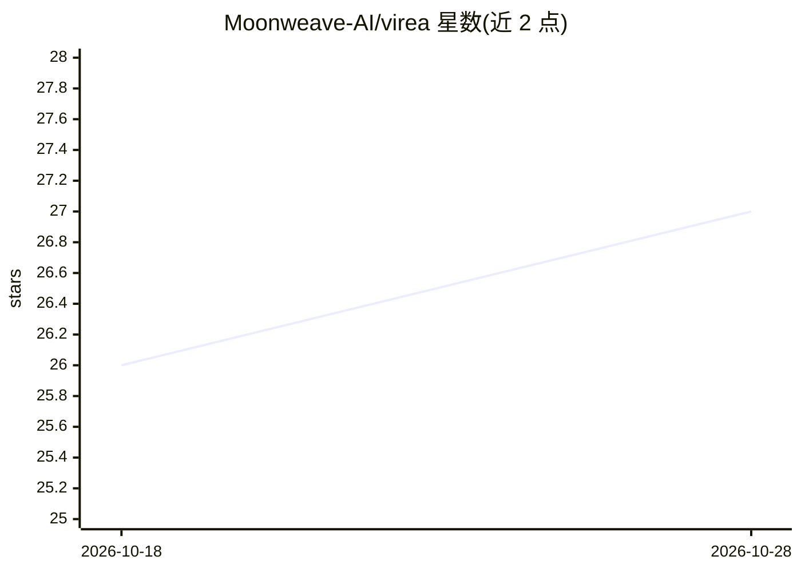

# Moonweave-AI/virea

⭐ 27 · Python · 推送 2026-10-13 · [GitHub](https://github.com/Moonweave-AI/virea) · 组织维护 · 中文 README

**给虚拟形象开发者的具身动作生成运行时：语言/语音/动作驱动 VRM 与 VRChat 虚拟形象**

面向虚拟形象应用开发者与创作者：通过适配器接入 MotionCraft、SynTalker、ARDY 等动作生成模型及云端或本地 LLM/TTS，将原始骨骼输出重定向到浏览器中的 VRM 形象和 VRChat Humanoid 形象。语音与动作拥有独立时间线，支持版本化消息、不可变工件与执行回执的检视路径。提供 Set Up、Motion Lab、Character Studio、VRChat Studio 四个工作区；浏览器功能跨三平台，VRChat 集成仅限 Windows。以源码加启动脚本方式分发，代码许可证尚未确定。

## 筛选速览

| 维度 | 判定 | 备注 |
|---|---|---|
| AI 角色 | `ai-native` | 本体是模型或模型工具 |
| 许可风险 | `none` | — |
| 部署形态 | `None` |  |
| 模型依赖 | — | README 未给出锁定关系 |
| 硬件要求 | — | 无带数字的原话,不猜 |
| 安装摩擦 | `low` | 无编译、无系统依赖或容器化 |
| 成熟度 | — | 结构信号不足 |

## 能力要点

- 原生骨骼输出重定向到 VRM 与 VRChat Humanoid 形象
- 语音与动作独立时间线编排，含版本化工件与执行回执
- 通过适配器组合多家动作模型，LLM/TTS 经类型化能力端口接入并可做生成验证
- 骨架检视支持手指、根运动与地面接触的对比检查

## 适用场景

- 让已有的 VRM 或 VRChat 虚拟形象由语言、语音与生成动作驱动
- 对比检视原始骨骼与目标形象的重定向结果
- 编排一次完整的语音加动作表演并交付到浏览器或 VRChat

## 场景标签

 · 领域:具身智能/虚拟形象动作生成

## 证据(README 行号)

> L14: **VIREA brings your existing avatars to life through language, speech and generated movement.** It retargets native
> L23:  02 · 🔌 Models you can combine Use MotionCraft, SynTalker, ARDY and other catalog models through adapters for their

## 星数曲线

2026-10-18 26 → 2026-10-28 27（+1）

---
*卡片 v1 · prompt 1.4 · 生成 2026-10-26 · 置信度 high · 依据 README sha `c34618e19329` · [字段定义](../../DATASET.md)*
