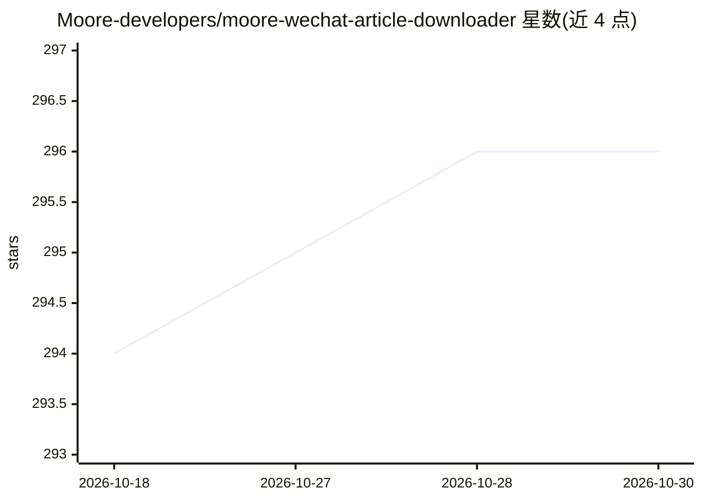

# Moore-developers/moore-wechat-article-downloader

⭐ 296 · Python · MIT · 推送 2026-08-01 · [GitHub](https://github.com/Moore-developers/moore-wechat-article-downloader) · 个人维护 · 中文 README

**本地微信公众号文章同步与归档工具，供 Codex/Claude Code 做内容研究**

以 Skill 形式安装到 Codex 或 Claude Code 的本地公众号资料库工具：通过公众号后台 Exporter 接口同步已关注公众号文章，保存正文、图片及页面实际提供的精选评论与互动数据，输出 Markdown、CSV 索引和 SQLite 状态，支持微信收藏会话边看边存与链接批量归档。本地优先，除访问微信文章和 Exporter 接口外不上传云端。限制：评论/互动依赖短时会话凭据且字段可能缺失；代理切换仅支持 macOS；README 声明自 2026 年 7 月 30 日微信关闭核心接口后暂停维护。

## 筛选速览

| 维度 | 判定 | 备注 |
|---|---|---|
| AI 角色 | `ai-ecosystem` | LLM/agent 周边工具 |
| 许可风险 | `permissive` | MIT |
| 部署形态 | `None` |  |
| 模型依赖 | — | README 未给出锁定关系 |
| 硬件要求 | — | 无带数字的原话,不猜 |
| 安装摩擦 | `low` | 无编译、无系统依赖或容器化 |
| 成熟度 | — | 结构信号不足 |

## 能力要点

- 同步关注公众号文章并保存精选评论与互动数据
- 输出 Markdown/CSV/SQLite 结构化本地资料库
- 微信桌面端“收藏到本地”现场保存当前文章
- 以 Skill 形式安装到 Codex 与 Claude Code

## 适用场景

- 长期跟踪竞品或关注公众号的选题与内容变化
- 把公众号阅读沉淀为可搜索的本地素材库
- 为 AI 工具准备结构化、可追溯的本地语料

## 场景标签

`网页抓取` `知识库管理` · 领域:效率与自动化

## 证据(README 行号)

> L31: 安装到 Codex：
> L39: 安装到 Claude Code：
> L62: - **AI 用户**：为 Codex、Claude Code 等工具准备结构化、可追溯的本地输入。

## 星数曲线

2026-10-18 294 → 2026-10-30 296（+2）

---
*卡片 v1 · prompt 1.4 · 生成 2026-10-21 · 置信度 high · 依据 README sha `9a11be48e41a` · [字段定义](../../DATASET.md)*
