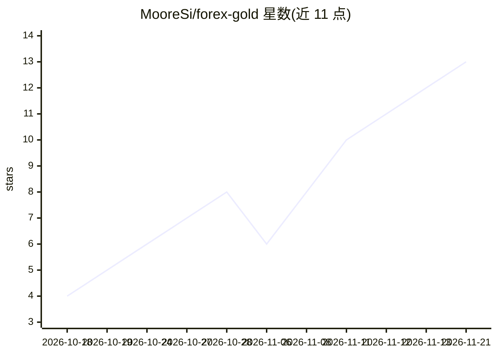

# MooreSi/forex-gold

⭐ 13 · Python · AGPL-3.0 · 推送 2026-11-18 · [GitHub](https://github.com/MooreSi/forex-gold) · 个人维护

**XAUUSD 自动化交易应用：解析 Telegram 信号并经 MT5 下单管理**

面向黄金（XAUUSD）交易的自动化系统：通过 Telethon 读取 Telegram 频道的交易信号并用按频道的确定性正则解析，配合两个内部研究引擎（Breakout 与 Reversal）生成信号；经确定性风控模块（Risk Governor）决定是否下单及仓位大小，通过 MetaTrader 5 执行并对持仓做分批止盈、保本、追踪止损管理。提供 FastAPI + React 本地仪表盘，支持本地或 VPS 运行，含回测与对账。README 明确说明会操作真实资金，声明不构成任何业绩承诺。

## 筛选速览

| 维度 | 判定 | 备注 |
|---|---|---|
| AI 角色 | `ai-enhanced` | 去掉 AI 部分产品仍成立 |
| 许可风险 | `viral` | AGPL-3.0 |
| 部署形态 | `desktop` | 安装包/桌面程序 |
| 模型依赖 | — | README 未给出锁定关系 |
| 硬件要求 | — | 无带数字的原话,不猜 |
| 安装摩擦 | `low` | 无编译、无系统依赖或容器化 |
| 成熟度 | — | 结构信号不足 |

## 能力要点

- 按频道确定性正则解析 Telegram 信号，含消息编辑修正与去重
- 两个相互隔离的内部信号引擎，各带独立 ML 模型与虚拟跟踪
- 确定性 Risk Governor：风险百分比仓位、日内亏损熔断、连败冷却
- 回测支持与对账机制，桥接中断可恢复

## 适用场景

- 把 Telegram 黄金信号频道接入 MT5 账户做结构化交易
- 在无人工信号的情况下运行自带引擎的模拟或实盘交易
- 在本地仪表盘查看每笔交易的决策记录与风控门控结果

## 场景标签

`金融量化` · 领域:学习与行业

## 证据(README 行号)

> L3: An automated XAUUSD (gold) trading application. It runs its own signal engines,
> L81: Alongside the human signals it runs **its own research engines** that generate
> L175: |**AI only where it earns it**|Model calls for format drift, market commentary and strategy advice — never in the 

## 星数曲线

2026-10-18 4 → 2026-11-21 13（+9）

---
*卡片 v1 · prompt 1.4 · 生成 2026-11-18 · 置信度 high · 依据 README sha `af5af5cb0e0c` · [字段定义](../../DATASET.md)*
