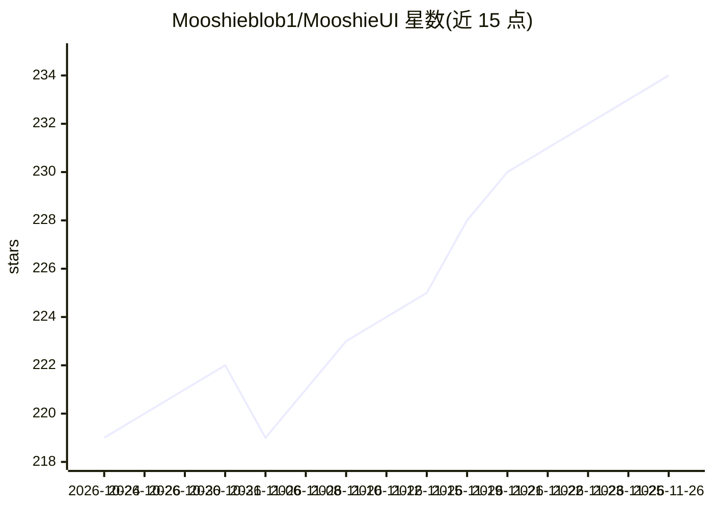

# Mooshieblob1/MooshieUI

⭐ 234 · TypeScript · AGPL-3.0 · 推送 2026-11-25 · [GitHub](https://github.com/Mooshieblob1/MooshieUI) · [官网](https://mooshieui.com) · 个人维护

**面向 ComfyUI 新手的多模态生成前端界面**

为 ComfyUI 提供图形化前端，将节点图操作封装为引导式工作流，支持图像生成与编辑、视频生成、音乐制作与图像转 3D，另可通过用户自备的 NovelAI API key 生成图像。以 Tauri 桌面应用（Windows/Linux/Apple Silicon macOS）或浏览器/服务器模式（支持 Docker、局域网、移动端）运行，内置画廊、元数据管理、多用户与权限控制。安装向导自动下载 uv、Python、ComfyUI 与 PyTorch，无需手动配置 Python 环境。

## 筛选速览

| 维度 | 判定 | 备注 |
|---|---|---|
| AI 角色 | `ai-native` | 本体是模型或模型工具 |
| 许可风险 | `viral` | AGPL-3.0 |
| 部署形态 | `desktop` | 安装包/桌面程序 |
| 模型依赖 | — | README 未给出锁定关系 |
| 硬件要求 | — | 无带数字的原话,不猜 |
| 安装摩擦 | `low` | 无编译、无系统依赖或容器化 |
| 成熟度 | — | 结构信号不足 |

## 能力要点

- 封装 ComfyUI 节点图为引导式工作流，覆盖图像/视频/音乐/3D 生成
- 桌面版安装向导自动下载 uv、Python、ComfyUI 与 PyTorch 并安装自定义节点
- 自托管 Web 服务器支持角色、多用户画廊、认证与移动端布局
- 12 种界面语言（含简繁中文），MCP 服务器供 Claude/Cursor 等助手调用生成功能

## 适用场景

- 不想手编 ComfyUI 节点图的新手进行图像生成
- 局域网内自托管多用户生成服务并通过手机访问
- 用已有 NovelAI 订阅配合本地 ComfyUI 做混合生成
- 通过 MCP 让 Claude Code/Cursor 等助手代为生成图像和音乐

## 场景标签

`图像生成` `视频生成` `多模态` · 领域:内容生成

## 证据(README 行号)

> L3: MooshieUI is a beginner-friendly interface for image, video, music and 3D generation through ComfyUI, with optional 
> L8: Built with **Svelte 5** + **Rust**, it hides ComfyUI's node-graph complexity behind a clean, guided workflow so you 
> L89: 2. Run the app. The setup wizard downloads uv, Python, ComfyUI, and PyTorch (NVIDIA, AMD, or Intel Arc GPU auto-det

## 星数曲线

2026-10-24 219 → 2026-11-26 234（+15）

---
*卡片 v1 · prompt 1.4 · 生成 2026-11-25 · 置信度 mid · 依据 README sha `d356271967eb` · [字段定义](../../DATASET.md)*
