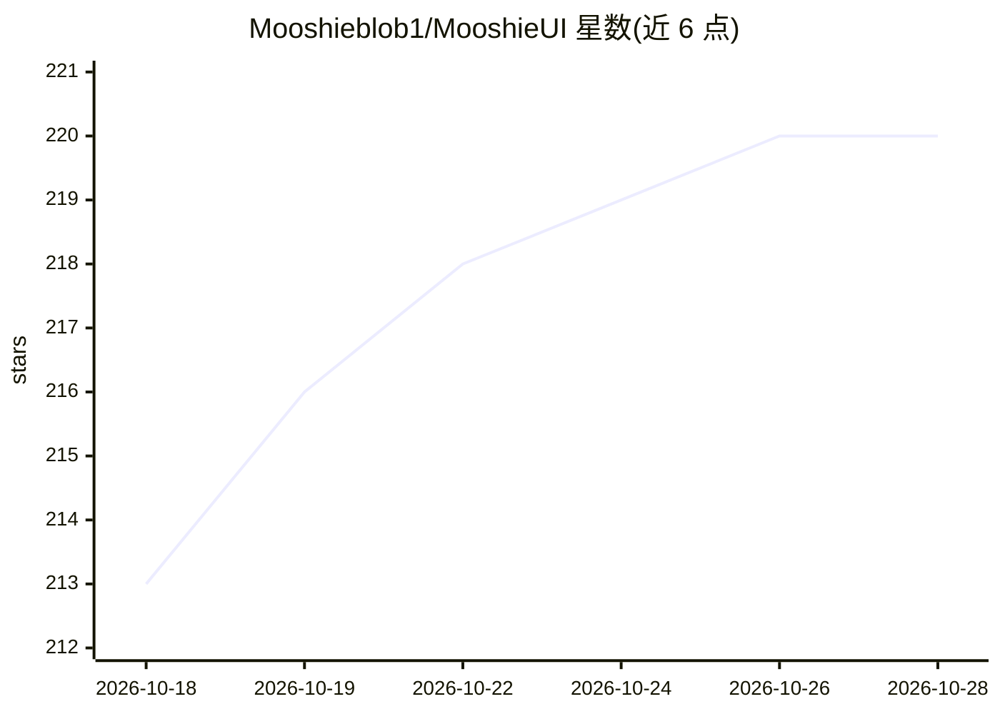

# Mooshieblob1/MooshieUI

⭐ 220 · TypeScript · AGPL-3.0 · 推送 2026-10-26 · [GitHub](https://github.com/Mooshieblob1/MooshieUI) · [官网](https://mooshieui.com) · 个人维护

**面向初学者的 ComfyUI 图像/视频/音乐生成前端界面**

用 Svelte 5 + Rust（Tauri 桌面端 + axum 网页服务器端）构建的 ComfyUI 图形前端，隐藏节点图复杂度，提供文生图、图生图、内置画布的局部重绘、Qwen Image Edit / Flux Kontext 图像编辑、MiniMax H3 文生视频、YuE2 音乐生成；也可选接 NovelAI API（用户自带 key）生成图像。桌面版安装向导自动下载 uv、Python、ComfyUI 与 PyTorch，支持 NVIDIA/AMD/Intel Arc GPU 自动检测；另提供 Docker 自托管多用户模式（角色、鉴权、每用户画廊、移动端布局）。支持 12 种语言。Rust 端从模板构建 ComfyUI workflow 并通过 REST/WebSocket 通信，附带自定义 ComfyUI 节点（tiled diffusion、face fix 等）自动安装。

## 筛选速览

| 维度 | 判定 | 备注 |
|---|---|---|
| AI 角色 | `ai-native` | 本体是模型或模型工具 |
| 许可风险 | `viral` | AGPL-3.0 |
| 部署形态 | `self-host` | docker 或自建部署 |
| 模型依赖 | — | README 未给出锁定关系 |
| 硬件要求 | — | 无带数字的原话,不猜 |
| 安装摩擦 | `low` | 无编译、无系统依赖或容器化 |
| 成熟度 | — | 结构信号不足 |

## 能力要点

- 文生图/图生图/画布局部重绘与 Qwen Image Edit、Flux Kontext 图像编辑
- MiniMax H3 视频生成与 YuE2 音乐工作室（MIDI 导出、播放列表）
- 桌面安装向导自动下载 Python/ComfyUI/PyTorch，支持 NVIDIA/AMD/Intel Arc
- Docker 自托管：角色、鉴权、每用户画廊与移动端布局；支持 12 种语言

## 适用场景

- 不想手改节点图的 ComfyUI 新手直接生成图像
- 在局域网或 Docker 中自托管多用户的生成服务
- 用自带 key 走 NovelAI API 生成图像并估算 Anlas 消耗

## 场景标签

`图像生成` `视频生成` · 领域:内容生成

## 证据(README 行号)

> L3: MooshieUI is a beginner-friendly interface for image, video and music generation through ComfyUI, with optional imag
> L8: Built with **Svelte 5** + **Rust**, it hides ComfyUI's node-graph complexity behind a clean, guided workflow so you 
> L118: 3. Rust builds an image, video or music ComfyUI workflow from templates, or a NovelAI image request using the sele

## 星数曲线

2026-10-18 213 → 2026-10-28 220（+7）

---
*卡片 v1 · prompt 1.4 · 生成 2026-10-22 · 置信度 mid · 依据 README sha `8f6a161832c0` · [字段定义](../../DATASET.md)*
