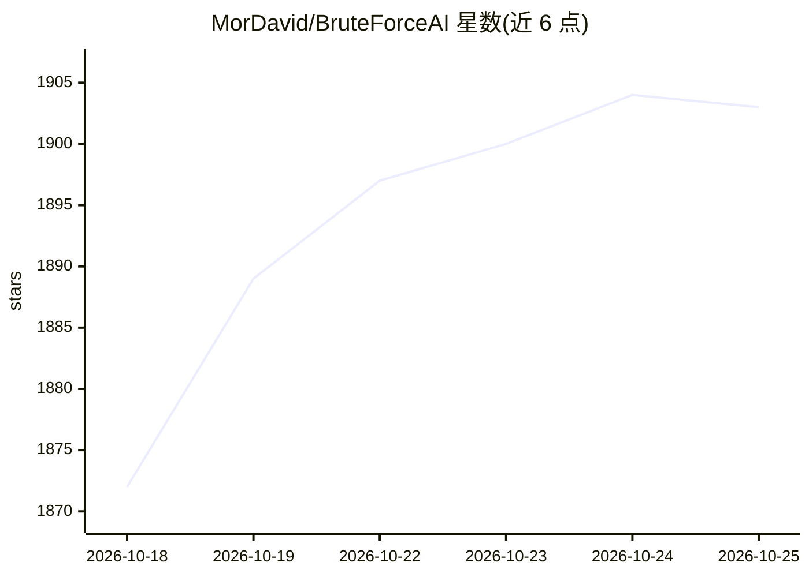

# MorDavid/BruteForceAI

⭐ 1,903 · Python · NOASSERTION · 推送 2026-07-17 · [GitHub](https://github.com/MorDavid/BruteForceAI) · [官网](https://www.MORDAVID.com) · 个人维护

**LLM 辅助分析登录表单的渗透测试爆破工具**

面向授权渗透测试与安全研究的 Python 命令行工具：分两阶段工作，先用 LLM（Ollama 本地或 Groq 云端）分析目标页面 HTML 识别登录表单选择器，再基于 Playwright 执行多线程暴力破解或密码喷洒攻击，支持人类行为模拟时序、User-Agent 轮换、代理等规避手段，成功后可经 Discord/Slack/Teams/Telegram webhook 通知，攻击记录存入 SQLite。README 声明仅限教育与授权测试，采用非商业许可。

## 筛选速览

| 维度 | 判定 | 备注 |
|---|---|---|
| AI 角色 | `ai-enhanced` | 去掉 AI 部分产品仍成立 |
| 许可风险 | `none` | NOASSERTION |
| 部署形态 | `library` | 以包/库形式分发 |
| 模型依赖 | local-ok | 支持本地模型 |
| 硬件要求 | — | 无带数字的原话,不猜 |
| 安装摩擦 | `low` | 无编译、无系统依赖或容器化 |
| 成熟度 | — | 结构信号不足 |

## 能力要点

- LLM 分析 HTML 识别登录表单选择器（Ollama/Groq 双通道）
- Bruteforce 与 Password Spray 两种攻击模式，1-100+ 线程
- User-Agent 轮换、延迟抖动、代理等规避配置
- Discord/Slack/Teams/Telegram webhook 通知与 SQLite 记录

## 适用场景

- 授权渗透测试中对目标登录页执行凭证爆破
- Bug bounty 项目范围内测试自有应用登录机制
- 安全研究中演示 LLM 辅助表单识别的攻击流程

## 场景标签

`网络安全` · 领域:学习与行业

## 证据(README 行号)

> L16: BruteForceAI is an advanced penetration testing tool that revolutionizes traditional brute-force attacks by integra
> L19: - **Stage 1 (AI Analysis)**: LLM analyzes HTML content to identify login form elements and selectors
> L349: - ✅ Authorized penetration testing

## 星数曲线

2026-10-18 1,872 → 2026-10-25 1,903（+31）

---
*卡片 v1 · prompt 1.4 · 生成 2026-10-21 · 置信度 mid · 依据 README sha `76819902a3b4` · [字段定义](../../DATASET.md)*
