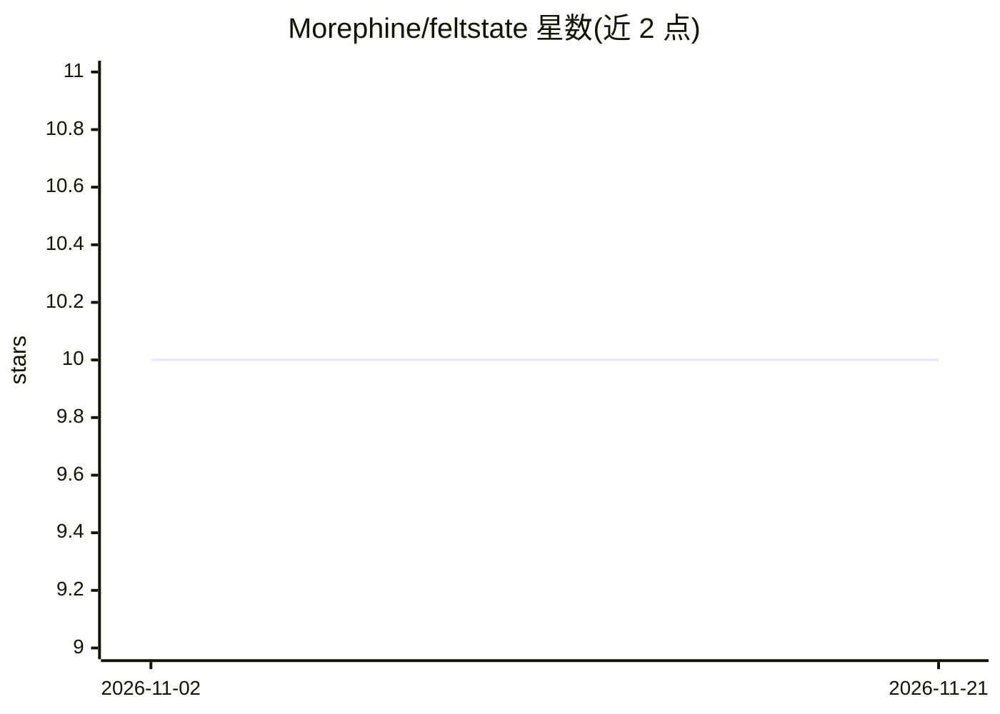

# Morephine/feltstate

⭐ 10 · Python · MIT · 推送 2026-10-05 · [GitHub](https://github.com/Morephine/feltstate) · 个人维护 · 中文 README

**给 AI agent 提供持久情感与可审计记忆的参考库**

feltstate 是面向长运行 agent 的 Python 角色引擎参考实现，由三套互锁系统加一张记忆关联网构成：5W1H 事实记忆生产线（衰减/强化/生命周期/审计链）、独立于回复模型的情感评估引擎（快情绪/慢气质/~180天可塑性层）、程序时间戳的双时序纪律，以及基于词键碰撞与逐对判定的关系网。核心为纯标准库，pip 可装；附带十六章集成手册，可组装带表情、语音的桌面陪伴体。

## 筛选速览

| 维度 | 判定 | 备注 |
|---|---|---|
| AI 角色 | `ai-ecosystem` | LLM/agent 周边工具 |
| 许可风险 | `permissive` | MIT |
| 部署形态 | `library` | 以包/库形式分发 |
| 模型依赖 | — | README 未给出锁定关系 |
| 硬件要求 | — | 无带数字的原话,不猜 |
| 安装摩擦 | `low` | 无编译、无系统依赖或容器化 |
| 成熟度 | — | 结构信号不足 |

## 能力要点

- 记忆带完整生命周期：指纹、融合谱系、墓碑式删除、哈希审计链
- 情感由独立组件评估，回复模型不能自写持久状态
- 零 LLM 的离线做梦（dreaming）与词键关系网，无向量索引
- 提供 config.py + PersonaDials 角色参数配置器

## 适用场景

- 给长期运行的 AI 陪伴/桌面宠物加上持久情绪与性格演化
- 为 agent 记忆增加可追溯的遗忘与删除审计
- 在无向量库条件下实现结构化事实记忆与关联检索

## 场景标签

`Agent 记忆` · 领域:Agent 开发

## 证据(README 行号)

> L24: feltstate is a **character engine for AI agents** — a small, opinionated
> L55: Around the engine sits an integration handbook —
> L5: > Mechanism: persistent affect is estimated by a component separate from the

## 星数曲线

2026-11-02 10 → 2026-11-21 10（+0）

---
*卡片 v1 · prompt 1.4 · 生成 2026-11-20 · 置信度 mid · 依据 README sha `f8ed7384d57a` · [字段定义](../../DATASET.md)*
