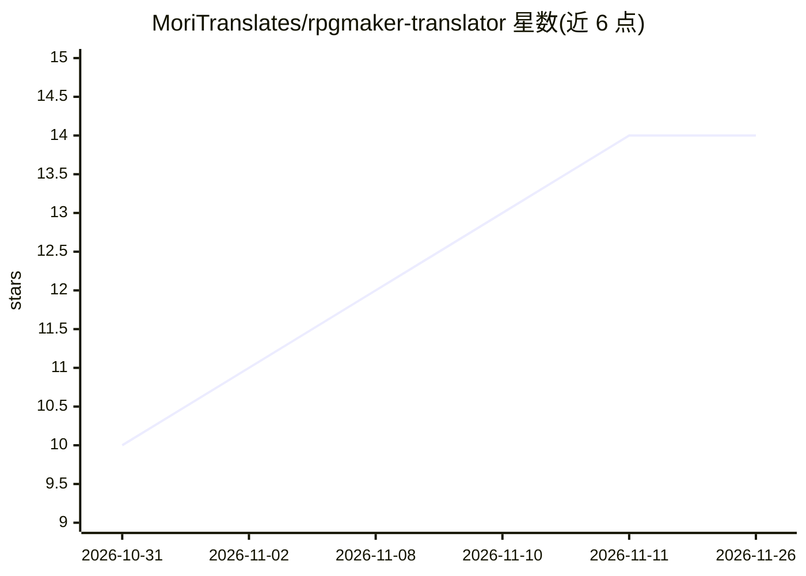

# MoriTranslates/rpgmaker-translator

⭐ 14 · Python · NOASSERTION · 推送 2026-11-22 · [GitHub](https://github.com/MoriTranslates/rpgmaker-translator) · [官网](https://github.com/MoriTranslates/rpgmaker-translator/releases/latest) · 个人维护

**用本地或云端 LLM 翻译 RPG Maker 等引擎日文游戏的桌面工具**

GUI 桌面应用，支持 11 种游戏引擎（RPG Maker MV/MZ/VX Ace/2000/2003、Wolf RPG、Ren'Py、TyranoScript、SRPG Studio、Kirikiri、Crowd）的自动翻译，打开游戏文件夹即自动检测引擎。提供本地 LLM（Ollama）与云端 API 两条路径；核心机制包括代词性别系统、双层词汇表、按事件分组翻译、翻译记忆去重、每 25 条自动存档与断点续翻。Windows 提供免 Python 的 zip 包，其他平台需从源码运行。

## 筛选速览

| 维度 | 判定 | 备注 |
|---|---|---|
| AI 角色 | `ai-native` | 本体是模型或模型工具 |
| 许可风险 | `none` | NOASSERTION |
| 部署形态 | `desktop` | 安装包/桌面程序 |
| 模型依赖 | local-ok | 支持本地模型 |
| 硬件要求 | — | 无带数字的原话,不猜 |
| 安装摩擦 | `low` | 无编译、无系统依赖或容器化 |
| 成熟度 | — | 结构信号不足 |

## 能力要点

- 支持 11 种引擎，打开文件夹自动检测
- 代词性别系统与双层词汇表保证译名与人称一致
- 翻译记忆去重与每 25 条自动存档、断点续翻
- 一键在 RPG Maker 可视化编辑器中 QA 与试玩译文

## 适用场景

- 把日文 RPG Maker 游戏批量翻译成可玩的中文/英文版本
- 无 GPU 时用云端 API 按量付费翻译游戏文本
- 译后在 RPG Maker 编辑器里校对并试玩

## 场景标签

 · 领域:游戏工具/机器翻译

## 证据(README 行号)

> L5: Translate RPG Maker MV/MZ/VX Ace/2000/2003, Ren'Py, TyranoScript, SRPG Studio, Kirikiri, Wolf RPG, and Crowd engine 
> L6:  Local LLM (Ollama + Sugoi or Qwen 3.5 — free, private, no content filters) or Cloud API (OpenAI, Gemini, DeepSeek, 
> L32: Open a game folder. Hit Batch Translate. Get a playable translation. Supports 11 engines — auto-detected on open.

## 星数曲线

2026-10-31 10 → 2026-11-26 14（+4）

---
*卡片 v1 · prompt 1.4 · 生成 2026-11-18 · 置信度 mid · 依据 README sha `208ccb29f355` · [字段定义](../../DATASET.md)*
