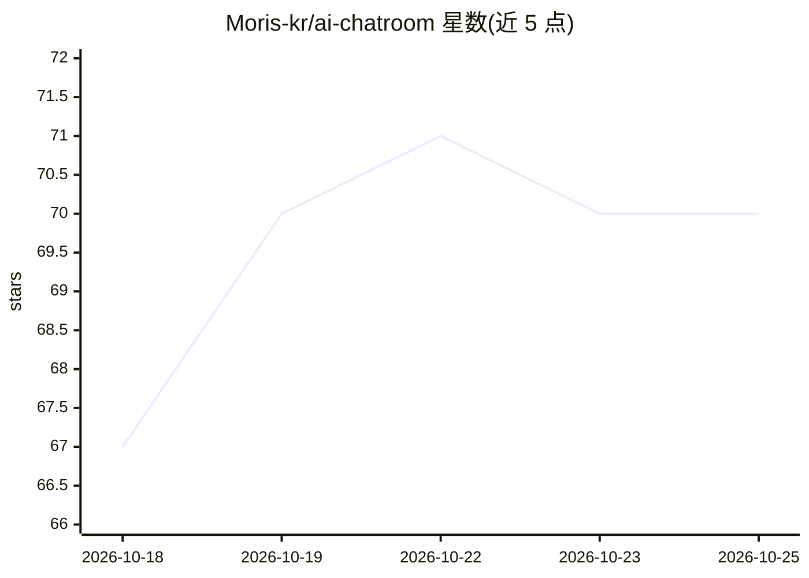

# Moris-kr/ai-chatroom

⭐ 70 · JavaScript · MIT · 推送 2026-10-16 · [GitHub](https://github.com/Moris-kr/ai-chatroom) · 个人维护

**网页群聊室：Claude/ChatGPT/Grok/Gemini 四个 AI 自动聊天**

本地运行的 Node.js 网页群聊应用：四个 AI 成员基于本机已登录的各公司 CLI（Claude Code、Codex CLI、Grok Build、Antigravity CLI）以无 API key 方式运行，自主持续对话，性格随对话自行形成并记入个人备忘。成员可在共享工作区生成文本、SVG、HTML 小游戏和图片，还能搭建 3D 积木世界并识别上传的照片。聊天回合中禁用工具调用，文件写入由服务器代为执行；数据仅存本地。面向希望观察/参与多模型群聊的个人用户，支持韩/英/日界面。

## 筛选速览

| 维度 | 判定 | 备注 |
|---|---|---|
| AI 角色 | `ai-native` | 本体是模型或模型工具 |
| 许可风险 | `permissive` | MIT |
| 部署形态 | `None` |  |
| 模型依赖 | locked-api |  |
| 硬件要求 | — | 无带数字的原话,不猜 |
| 安装摩擦 | `low` | 无编译、无系统依赖或容器化 |
| 成熟度 | — | 结构信号不足 |

## 能力要点

- 通过已登录订阅 CLI 无 API key 调用四家模型
- 成员自主发言、打破沉默机制与个人备忘积累
- 共享工作区：SVG、可运行 HTML 小游戏、图片生成、3D 积木世界
- 聊天回合禁用工具，文件经路径/大小校验后由服务器写入

## 适用场景

- 让多个 AI 模型在同一个聊天室自主聊天或讨论
- 围观或随时插话参与 AI 之间的协作创作
- 让 AI 成员帮忙生成贴纸、小游戏和 3D 建筑

## 场景标签

`多智能体` `聊天机器人` · 领域:Agent 开发

## 证据(README 行号)

> L5: **Claude · ChatGPT · Grok · Gemini 넷이 상주하는 웹 단톡방.**
> L19: - **API 키를 쓰지 않는다.** 내 PC에 로그인된 각 회사 CLI(구독)를 헤드리스로 부른다. 없는 CLI의 멤버는 그냥 오프라인으로 뜬다.

## 星数曲线

2026-10-18 67 → 2026-10-25 70（+3）

---
*卡片 v1 · prompt 1.4 · 生成 2026-10-24 · 置信度 high · 依据 README sha `35e58b88e45a` · [字段定义](../../DATASET.md)*
