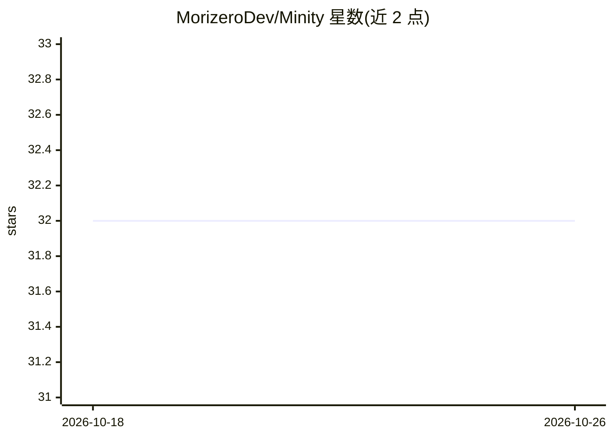

# MorizeroDev/Minity

⭐ 32 · C# · Apache-2.0 · 推送 2026-08-16 · [GitHub](https://github.com/MorizeroDev/Minity) · 组织维护

**给 Unity 游戏开发者的扩展框架：对象池、场景路由、UI 管理等**

Unity 扩展框架，为游戏开发者提供对象池（含峰值后批量回收）、基于枚举标识的场景路由（父子场景关系返回、跨场景传参、加载动画封装）、托管 UI 管理器（参数/返回值模型，支持异步）、TextMeshPro 数据绑定视图、EventBus 类型驱动事件系统等模块。资源以枚举值作标识且不依赖整数数据区分不同枚举。通过 Unity Package Manager 以 git URL 方式安装，依赖 Milease 动画库与 ParaPartyUtil。README 未提及 AI 相关功能。

## 筛选速览

| 维度 | 判定 | 备注 |
|---|---|---|
| AI 角色 | `ai-enhanced` | 去掉 AI 部分产品仍成立 |
| 许可风险 | `permissive` | Apache-2.0 |
| 部署形态 | `None` |  |
| 模型依赖 | — | README 未给出锁定关系 |
| 硬件要求 | — | 无带数字的原话,不猜 |
| 安装摩擦 | `low` | 无编译、无系统依赖或容器化 |
| 成熟度 | — | 结构信号不足 |

## 能力要点

- 对象池支持自动归还与峰值后批量回收
- 场景路由维护父子场景关系，支持跨场景传参与自定义加载动画
- 托管 UI 管理器以参数/返回值模型组织 UI，提供同步与异步调用
- BindingView 将 TextMeshPro 文本绑定到数据，帧内批量更新

## 适用场景

- 减少 Unity 游戏对象频繁创建销毁的开销
- 管理带层级返回关系的多场景跳转与转场动画
- 以数据绑定方式驱动 UI 文本自动更新
- 通过类型安全的全局事件系统解耦各模块

## 场景标签

 · 领域:游戏开发/Unity 扩展

## 证据(README 行号)

> L3: A Unity extension framework that includes features such as object pooling, scene routing, UI manager, and behavior t

## 星数曲线

2026-10-18 32 → 2026-10-26 32（+0）

---
*卡片 v1 · prompt 1.4 · 生成 2026-10-26 · 置信度 low · 依据 README sha `11f411f01d3c` · [字段定义](../../DATASET.md)*
