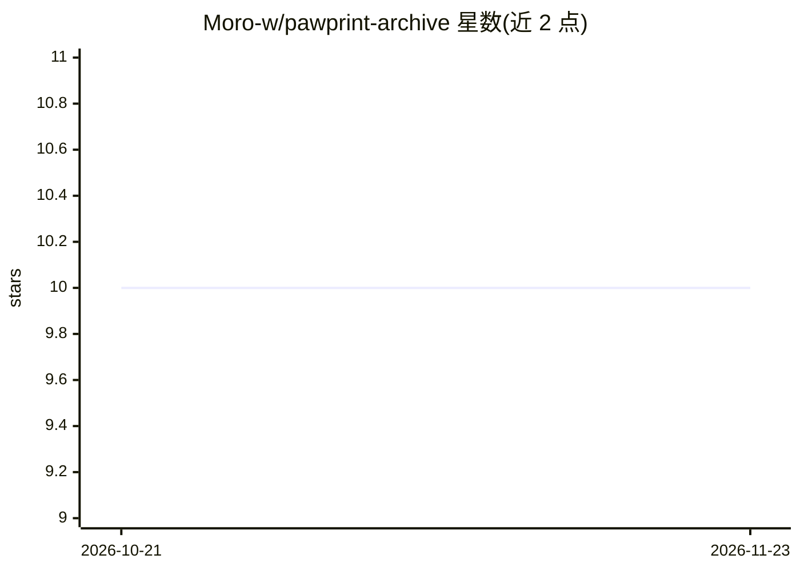

# Moro-w/pawprint-archive

⭐ 10 · Python · 推送 2026-09-07 · [GitHub](https://github.com/Moro-w/pawprint-archive) · 个人维护 · 中文 README

**给宠物主人的记忆档案与对话 Web App 原型**

前后端源码形式的宠物记忆管理 Web App 原型：建立宠物档案、记录共同经历，将记忆结构化保存并经 Chroma 向量检索后组织对话上下文，对话接口返回相关记忆引用并可查看记忆详情。后端 FastAPI + SQLite + Chroma，前端 Next.js；模型使用 DeepSeek deepseek-chat，API Key 需自行配置。README 明示为持续迭代中的原型，未提供公开体验地址，测试中 LLM 与向量已 mock。

## 筛选速览

| 维度 | 判定 | 备注 |
|---|---|---|
| AI 角色 | `ai-native` | 本体是模型或模型工具 |
| 许可风险 | `none` | — |
| 部署形态 | `library` | 以包/库形式分发 |
| 模型依赖 | locked-api |  |
| 硬件要求 | — | 无带数字的原话,不猜 |
| 安装摩擦 | `low` | 无编译、无系统依赖或容器化 |
| 成熟度 | `idea` | |

## 能力要点

- 长期记忆与聊天记录分开管理，检索后再组织对话上下文
- 对话接口返回相关记忆引用，前端提供记忆详情页
- RAG 检索基于本地 Chroma 向量库
- 提供 API、记忆解析与对话服务的 pytest 测试（LLM 已 mock，离线可跑）

## 适用场景

- 记录并检索与宠物共同经历的记忆
- 带着相关记忆与 AI 进行宠物对话
- 回顾对话中引用的记忆详情

## 场景标签

`RAG` · 领域:知识与检索

## 证据(README 行号)

> L3: 面向宠物主人的 AI 关系档案 Web App：把共同经历整理为可检索、可回顾、可对话的长期记忆。
> L39: - 模型：DeepSeek `deepseek-chat`
> L44: backend/    FastAPI 后端（API、LLM、RAG、数据持久化）

## 星数曲线

2026-10-21 10 → 2026-11-23 10（+0）

---
*卡片 v1 · prompt 1.4 · 生成 2026-11-20 · 置信度 high · 依据 README sha `44f71f415223` · [字段定义](../../DATASET.md)*
