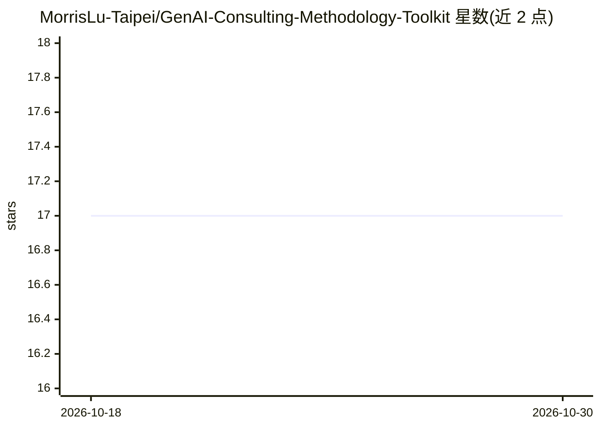

# MorrisLu-Taipei/GenAI-Consulting-Methodology-Toolkit

⭐ 17 · HTML · Apache-2.0 · 推送 2026-06-21 · [GitHub](https://github.com/MorrisLu-Taipei/GenAI-Consulting-Methodology-Toolkit) · [官网](https://github.com/MorrisLu-Taipei/GenAI-Consulting-Methodology-Toolkit) · 个人维护 · 中文 README

**企业 GenAI 转型成熟度诊断与导入方法论工具包（L1-L5）**

由顾问 Morris Lu 维护的 Markdown 方法论文档库：以 L1-L5 五级 AI 成熟度模型（规模轴 L1-L3 / AI 自主轴 L4-L5）与八阶段顾问流程为核心，含成熟度问卷、BARS 评分锚点、L1-L5 课程计划、诊断报告模板、制造/医院等模拟案例与交付验收矩阵。README 称其为『AI-Native Living Book』：git clone 后用 AI IDE（Antigravity / Codex CLI / Claude Code）打开，AI 读 AGENTS.md 定位为共读导师，可回答问题、套用企业情境、跑诊断。所有具名案例声明为 AI 模拟虚构。Apache 2.0。

## 筛选速览

| 维度 | 判定 | 备注 |
|---|---|---|
| AI 角色 | `ai-knowledge` | 知识聚合/清单类 |
| 许可风险 | `permissive` | Apache-2.0 |
| 部署形态 | `None` |  |
| 模型依赖 | — | README 未给出锁定关系 |
| 硬件要求 | — | 无带数字的原话,不猜 |
| 安装摩擦 | `low` | 无编译、无系统依赖或容器化 |
| 成熟度 | — | 结构信号不足 |

## 能力要点

- L1-L5 成熟度模型（个人→部门→全公司→AI 超级助理→AI 团队）与每层 Input/Process/Output/Evidence/Stage Gate 验收矩阵
- 八阶段顾问结构另附 SME Lite（4 阶段/3 个月）与 SOHO（2 阶段/1 周）压缩路径
- 三 AI 引擎分工：Antigravity 前线顾问、Codex CLI 方法论稽核、Claude Code 跨档思考
- 对齐 NIST AI RMF / EU AI Act / ISO 42001，提供 7 大理论支柱与学术致谢

## 适用场景

- 顾问用 AI IDE 打开做企业 AI 成熟度诊断与导入交付
- CEO 快速获得公司成熟度层级与下一步判断
- 监管/法遵获取可审计证据链并对齐治理框架
- 学者引用成熟度模型的理论基础与研究故事

## 场景标签

`教程课程` · 领域:学习与行业

## 证据(README 行号)

> L7: 企業 AI 轉型成熟度診斷與導入方法論工具包。
> L11: > 📚 **本 repo 是「AI-Native 顧問方法論系列」總庫**(同時收錄上集、下集、研究與系列入口),不是單一本書:
> L241: **操作模型一句話**：`git clone` 或下載 zip → 用 AI IDE（Antigravity / Claude Code / Codex 等）打開 → AI 自動讀 `AGENTS.md`（與各引擎自己的 `<E

## 星数曲线

2026-10-18 17 → 2026-10-30 17（+0）

---
*卡片 v1 · prompt 1.4 · 生成 2026-10-30 · 置信度 high · 依据 README sha `d176bb4ec17e` · [字段定义](../../DATASET.md)*
