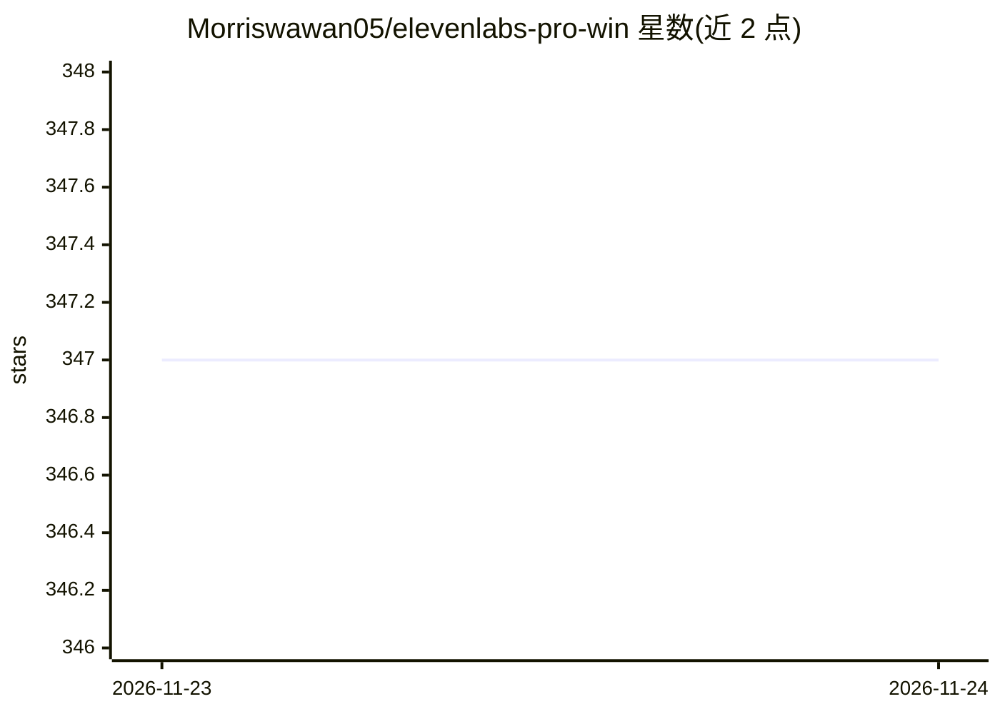

# Morriswawan05/elevenlabs-pro-win

⭐ — · [GitHub]() · 个人维护

**面向 Windows 用户的 ElevenLabs AI 语音合成安装与使用指南**

为 Windows 10/11 平台的 ElevenLabs Pro 语音合成平台提供参考与安装指引：涵盖文本转语音、语音克隆、多语言配音的首启流程与工作区操作步骤。用户输入脚本、指定或克隆声音、调节稳定性与风格参数后预览并导出音频。安装包来自官方来源，需管理员权限与联网激活，依赖 .NET Framework 4.8 与 Visual C++ Redistributable，x64 架构。许可证信息未在 README 中给出。

## 筛选速览

| 维度 | 判定 | 备注 |
|---|---|---|
| AI 角色 | `ai-native` | 本体是模型或模型工具 |
| 许可风险 | `none` | — |
| 部署形态 | `None` |  |
| 模型依赖 | — | README 未给出锁定关系 |
| 硬件要求 | — | 无带数字的原话,不猜 |
| 安装摩擦 | `low` | 无编译、无系统依赖或容器化 |
| 成熟度 | — | 结构信号不足 |

## 能力要点

- 文本转语音生成，支持稳定性、清晰度与风格参数调节
- 基于自有音频样本创建自定义语音克隆并存入语音库
- 多语言配音：翻译并重新配音，保留原始时序
- 语音设计控制、脚本编辑器、音频导出与项目历史管理

## 适用场景

- 在 Windows 上生成旁白、有声书与播客配音
- 用自己录制的人声样本克隆并复用品牌声音
- 为视频内容做多语言本地化配音与导出

## 场景标签

`语音合成` · 领域:内容生成

## 证据(README 行号)

> L19: Elevenlabs Pro is an AI voice synthesis platform for Windows that turns written text into natural-sounding speech, 
> L42: - **Text-to-Speech Generation**: Convert written scripts into natural speech with adjustable stability, clarity, an
> L55: 1. **Installation**: Download the installation package from the official source for Elevenlabs Pro. Run the install

## 星数曲线

2026-11-23 347 → 2026-11-24 347（+0）

---
*卡片 v1 · prompt 1.4 · 生成 2026-11-23 · 置信度 mid · 依据 README sha `b376cbec8a43` · [字段定义](../../DATASET.md)*
