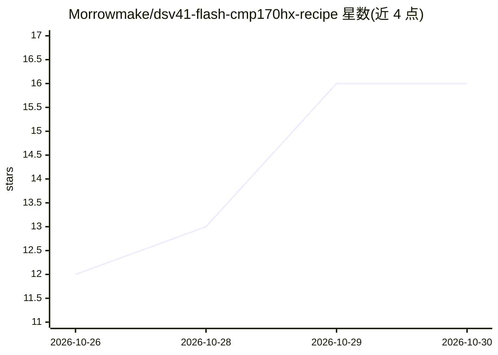

# Morrowmake/dsv41-flash-cmp170hx-recipe

⭐ 16 · Python · MIT · 推送 2026-10-26 · [GitHub](https://github.com/Morrowmake/dsv41-flash-cmp170hx-recipe) · 个人维护

**在 4×CMP 170HX 上以 vLLM 部署 DeepSeek-V4.1-Flash 的一键容器方案**

面向拥有四张 NVIDIA CMP 170HX（Ampere sm_80，各 64 GiB）的用户的部署配方：通过带 Ampere 内核补丁的 vLLM fork，以张量并行 4 + P2P 方式服务 DeepSeek-V4.1-Flash（262K 上下文，EXL3 2.9bpw 路由专家 + FP8/BF16 其余权重），提供 OpenAI 兼容 API、工具调用、推理输出与 DSpark 投机解码。仅以容器镜像运行，./start.sh 或 Docker Compose 一条命令完成拉取、模型下载与启动。限制：需 PCIe Gen2 x16 链路、约 240 GiB 主机内存、NVIDIA 驱动 580+、约 680 GiB 磁盘。

## 筛选速览

| 维度 | 判定 | 备注 |
|---|---|---|
| AI 角色 | `ai-ecosystem` | LLM/agent 周边工具 |
| 许可风险 | `permissive` | MIT |
| 部署形态 | `self-host` | docker 或自建部署 |
| 模型依赖 | local-ok | 支持本地模型 |
| 硬件要求 | — | 无带数字的原话,不猜 |
| 安装摩擦 | `low` | 无编译、无系统依赖或容器化 |
| 成熟度 | — | 结构信号不足 |

## 能力要点

- 单用户最高 319 tok/s、8 并发合计最高 765 tok/s、262K 上下文
- vLLM fork 补充 Ampere sm_80 内核使模型可在 CMP 170HX 上运行
- ./start.sh 一条命令完成镜像拉取、模型下载、启动与健康检查，可幂等重跑与断点续传
- DSpark 投机解码（单用户最多前探 7 token）与 OpenAI 兼容 API（含工具调用/图像/推理字段）

## 适用场景

- 我用 4 张 CMP 170HX 搭一台本地 DeepSeek-V4.1-Flash 推理服务
- 为团队提供 262K 长上下文、8 并发的 OpenAI 兼容 API 端点
- 在 Ampere 挖矿卡上复用现有硬件跑 MoE 大模型

## 场景标签

`推理引擎` · 领域:训练与推理

## 证据(README 行号)

> L20: This repository installs and runs **DeepSeek-V4.1-Flash-1017** on **four NVIDIA
> L24: vLLM fork adds the

## 星数曲线

2026-10-26 12 → 2026-10-30 16（+4）

---
*卡片 v1 · prompt 1.4 · 生成 2026-10-30 · 置信度 high · 依据 README sha `e193803617e7` · [字段定义](../../DATASET.md)*
