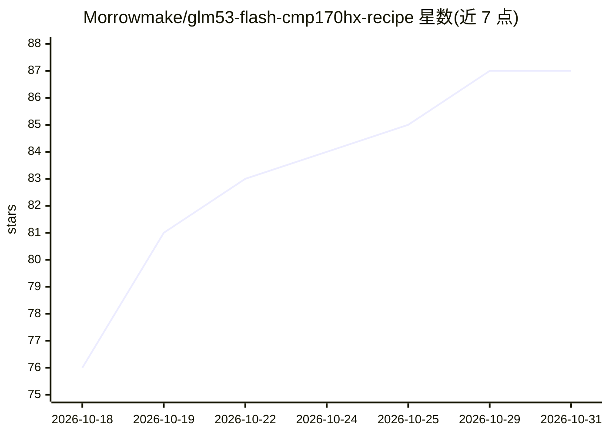

# Morrowmake/glm53-flash-cmp170hx-recipe

⭐ 87 · Python · MIT · 推送 2026-10-26 · [GitHub](https://github.com/Morrowmake/glm53-flash-cmp170hx-recipe) · 个人维护

**在 4× CMP 170HX 上以 vLLM fork 运行 GLM-5.3-Flash 的部署方案**

面向持有 4× NVIDIA CMP 170HX 的开发者的部署配方（recipe）：通过 Ampere 内核补丁的 vLLM fork，以容器方式运行 W4A16 量化的 GLM-5.3-Flash（320B MoE、262K 上下文），提供 OpenAI 兼容 API、工具调用、多模态输入与 DFlash2 投机解码。支持 TP4/PP4 两种布局，一键 start.sh 或 Docker Compose 启动，自动下载模型权重并带冒烟测试。限制：仅以容器形式运行，需 NVIDIA 驱动 580+ 与 NVIDIA Container Toolkit，约 180 GiB 磁盘。

## 筛选速览

| 维度 | 判定 | 备注 |
|---|---|---|
| AI 角色 | `ai-ecosystem` | LLM/agent 周边工具 |
| 许可风险 | `permissive` | MIT |
| 部署形态 | `self-host` | docker 或自建部署 |
| 模型依赖 | local-ok | 支持本地模型 |
| 硬件要求 | — | 无带数字的原话,不猜 |
| 安装摩擦 | `low` | 无编译、无系统依赖或容器化 |
| 成熟度 | — | 结构信号不足 |

## 能力要点

- vLLM fork 添加 Ampere (sm_80) 内核，使模型可在 CMP 170HX 上运行
- TP4/PP4 双布局切换，TP4 单用户 482.6 tok/s、8 用户 943.7 tok/s
- OpenAI 兼容 API，支持工具调用、推理输出与图像/视频输入
- DFlash2 投机解码（单用户最多前视 7 token）

## 适用场景

- 在 4 张 CMP 170HX 挖矿卡上本地部署 GLM-5.3-Flash
- 以 OpenAI 兼容 API 为本地客户端提供长上下文推理服务
- 在 PCIe x4 链路受限时切换 PP4 布局服务多并发用户

## 场景标签

`推理引擎` · 领域:训练与推理

## 证据(README 行号)

> L20: This repository installs and runs **GLM-5.3-Flash** on **four NVIDIA CMP 170HX
> L24: vLLM fork adds
> L26: patches on making it fast and making it repeatable. It runs only as a container

## 星数曲线

2026-10-18 76 → 2026-10-31 87（+11）

---
*卡片 v1 · prompt 1.4 · 生成 2026-10-24 · 置信度 high · 依据 README sha `db617fa09ac1` · [字段定义](../../DATASET.md)*
