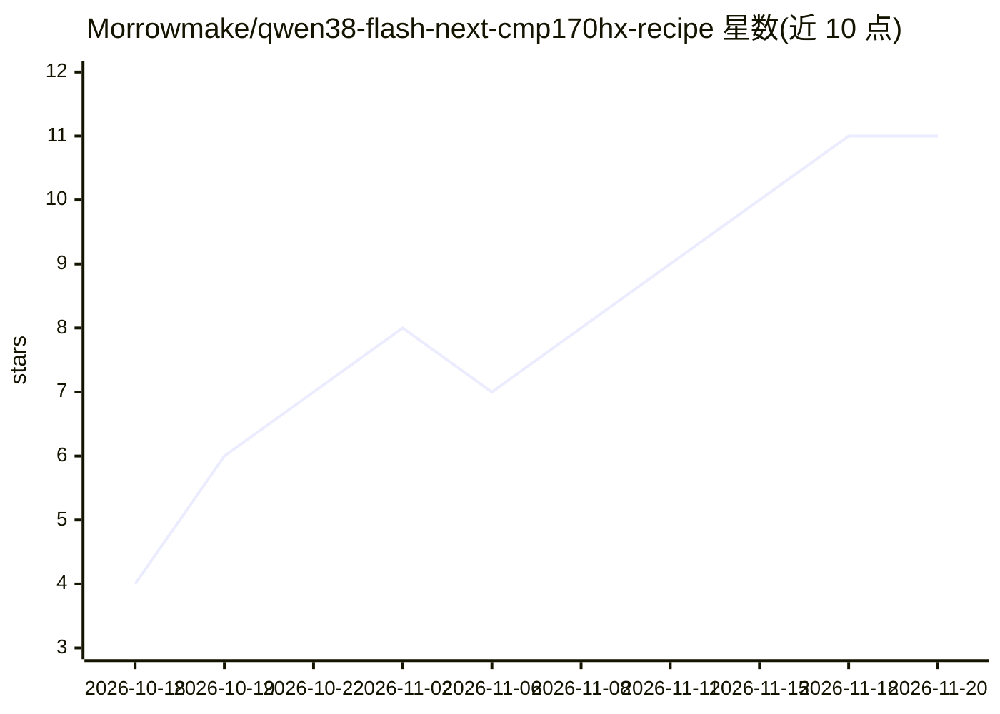

# Morrowmake/qwen38-flash-next-cmp170hx-recipe

⭐ 11 · Python · MIT · 推送 2026-10-26 · [GitHub](https://github.com/Morrowmake/qwen38-flash-next-cmp170hx-recipe) · 个人维护

**在 2×CMP 170HX 上用 vLLM 部署 Qwen3.8-Flash-Next 的一键配方**

一个部署配方仓库：在两张 NVIDIA CMP 170HX 显卡上以张量并行 2 运行 Qwen3.8-Flash-Next（EXL3 5.05 bpw 量化），使用打了补丁的 vLLM 引擎，提供 OpenAI 兼容 API、262,144 token 上下文、MTP 投机解码、视觉与工具调用。引擎以 digest 固定的容器交付，克隆后一条命令完成拉取镜像、下载权重、启动与健康检查；提供 start.sh 与 Docker Compose 两种入口，附测量数据（1 用户 152.8 tok/s，8 用户 674.7 tok/s）与可切换的 EXL3 内核开关。限制：仅支持双卡 TP2 配置，上下文与显存占比固定。

## 筛选速览

| 维度 | 判定 | 备注 |
|---|---|---|
| AI 角色 | `ai-ecosystem` | LLM/agent 周边工具 |
| 许可风险 | `permissive` | MIT |
| 部署形态 | `self-host` | docker 或自建部署 |
| 模型依赖 | local-ok | 支持本地模型 |
| 硬件要求 | — | 无带数字的原话,不猜 |
| 安装摩擦 | `low` | 无编译、无系统依赖或容器化 |
| 成熟度 | — | 结构信号不足 |

## 能力要点

- 一条命令容器化部署：拉镜像、下载 checkpoint、启动、/health 等待全自动
- 补丁版 vLLM 引擎 + EXL3 5.05 bpw 权重 + 原生 MTP 投机解码（3 draft tokens）
- 提供 OpenAI 兼容 API，支持视觉、推理输出与工具调用
- 可开关的 13 个 EXL3/自定义内核选项，关闭后解码延迟上升 18%–56%

## 适用场景

- 让两张 CMP 170HX 矿卡跑起本地大模型推理服务
- 本地搭建 262K 上下文的 OpenAI 兼容 API 服务
- 复现并核对已验证的推理部署环境与性能数据

## 场景标签

`推理引擎` · 领域:训练与推理

## 证据(README 行号)

> L14: (EXL3, 5.05 bpw) on two NVIDIA CMP 170HX cards with a patched vLLM: an
> L16: speculative decoding, vision, reasoning and tool calls. The engine runs only
> L17: in a container pinned by digest. One command from a fresh clone, after the

## 星数曲线

2026-10-18 4 → 2026-11-20 11（+7）

---
*卡片 v1 · prompt 1.4 · 生成 2026-11-19 · 置信度 high · 依据 README sha `3edb40c33baa` · [字段定义](../../DATASET.md)*
