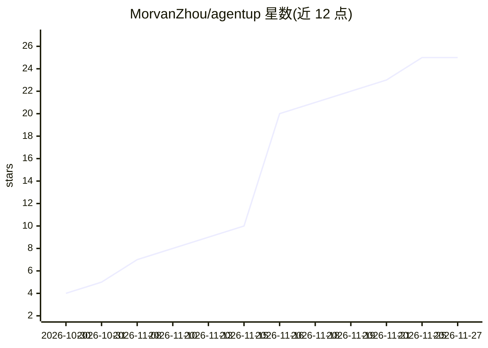

# MorvanZhou/agentup

⭐ 25 · TypeScript · MIT · 推送 2026-11-25 · [GitHub](https://github.com/MorvanZhou/agentup) · [官网](https://agentup.me) · 个人维护 · 中文 README

**本地优先的桌面 IM：像加好友一样添加并协作使用 AI 助手**

AgentUp 是开源桌面应用（Electron + Vue）加本地 Node supervisor 运行时，把多助手协作用即时通讯形态组织：每个助手对应一类任务、各占一个独立聊天，任务跨领域时助手之间相互协作完成。助手可读取本机文件并把结果（如 PPT）写回桌面，聊天默认留在本地。接入方式两种：本地 agent（Cursor、Claude Code、Codex 等）或模型 API，支持自建 OpenAI 兼容端点。需 Node 与 pnpm，从源码构建运行。

## 筛选速览

| 维度 | 判定 | 备注 |
|---|---|---|
| AI 角色 | `ai-native` | 本体是模型或模型工具 |
| 许可风险 | `permissive` | MIT |
| 部署形态 | `library` | 以包/库形式分发 |
| 模型依赖 | local-ok | 支持本地模型 |
| 硬件要求 | — | 无带数字的原话,不猜 |
| 安装摩擦 | `low` | 无编译、无系统依赖或容器化 |
| 成熟度 | — | 结构信号不足 |

## 能力要点

- IM 形态管理多助手：像加联系人一样添加，一个助手一类聊天
- 助手间协作：跨角色任务由个人助手拉取合适队友共同完成
- 本地运行时：读取桌面文件并把结果写回本地
- 双通道接入：本地 agent 与多家模型 API（含自定义 OpenAI 兼容端点）

## 适用场景

- 把论文、写代码、查天气等不同事务分给不同助手分别聊
- 组建产品/设计/前后端分工的 agent 团队协作完成任务
- 在本地处理文件并让生成的文档直接落盘

## 场景标签

`多智能体` `AI 助手` `编码 Agent` · 领域:Agent 开发

## 证据(README 行号)

> L20: **AgentUp** is an open-source desktop app for multi-agent collaboration. Study, write, look things up, plan a trip 
> L101: AgentUp is a local runtime: local agents on the left, model APIs on the right. Pick one to chat — or use both.

## 星数曲线

2026-10-30 4 → 2026-11-27 25（+21）

---
*卡片 v1 · prompt 1.4 · 生成 2026-11-18 · 置信度 mid · 依据 README sha `2613fd4e63a6` · [字段定义](../../DATASET.md)*
