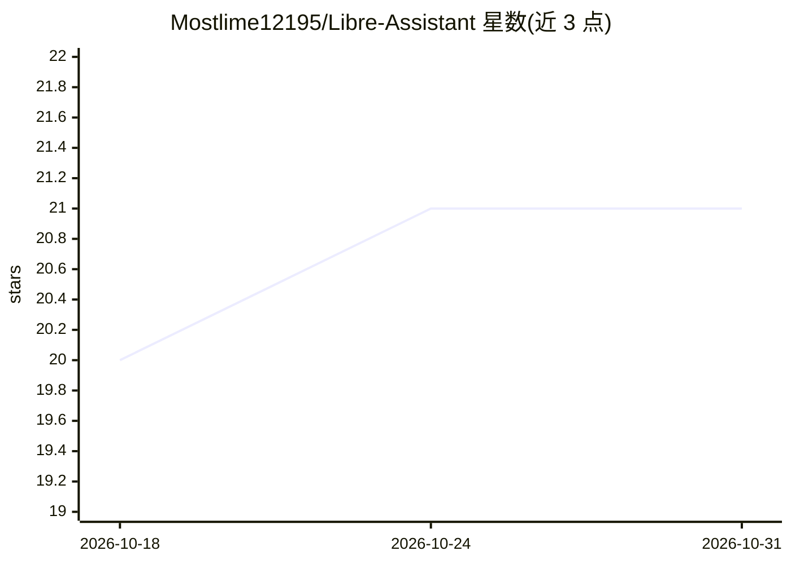

# Mostlime12195/Libre-Assistant

⭐ 21 · JavaScript · 推送 2026-08-27 · [GitHub](https://github.com/Mostlime12195/Libre-Assistant) · [官网](https://libreassistant.dino.icu) · 个人维护

**开源私密 AI 聊天界面，支持本地与云端 API**

以 Hack Club AI 为主、同时支持外部云端与本地 OpenAI 兼容 API 的开源聊天界面。所有聊天与用户数据存储在本设备，不出售用户信息。功能包括 Markdown/LaTeX 渲染、文档与图片上传、图像生成、带代码执行的沙盒本地项目与工作区、网页搜索与爬取工具、无痕模式、跨对话可选笔记、对话分支与上下文压缩。基于 Nuxt 构建，通过 git clone 加 npm install 从源码运行，需设置 NUXT_SESSION_SECRET 环境变量；语音输入在 Todo 中尚未实现。

## 筛选速览

| 维度 | 判定 | 备注 |
|---|---|---|
| AI 角色 | `ai-native` | 本体是模型或模型工具 |
| 许可风险 | `none` | — |
| 部署形态 | `library` | 以包/库形式分发 |
| 模型依赖 | — | README 未给出锁定关系 |
| 硬件要求 | — | 无带数字的原话,不猜 |
| 安装摩擦 | `low` | 无编译、无系统依赖或容器化 |
| 成熟度 | — | 结构信号不足 |

## 能力要点

- 全部数据本地存储，不销售用户信息
- 沙盒本地项目与工作区支持代码执行
- 支持图像生成、网页搜索与爬取工具
- 对话分支、上下文压缩与无痕模式

## 适用场景

- 在本设备上私密地与 AI 模型对话
- 接入本地或云端 OpenAI 兼容 API 使用
- 在沙盒工作区中结合代码执行与 AI 协作

## 场景标签

`聊天机器人` `AI 助手` `图像生成` · 领域:对话与助手

## 证据(README 行号)

> L3: Libre Assistant is an open-source AI interface primarily for Hack Club AI, but with support for external cloud & loc
> L4: Libre Assistant does **not** sell or store user information, and all chat & user data is stored on your device.

## 星数曲线

2026-10-18 20 → 2026-10-31 21（+1）

---
*卡片 v1 · prompt 1.4 · 生成 2026-10-28 · 置信度 high · 依据 README sha `9b8268ff4c4b` · [字段定义](../../DATASET.md)*
