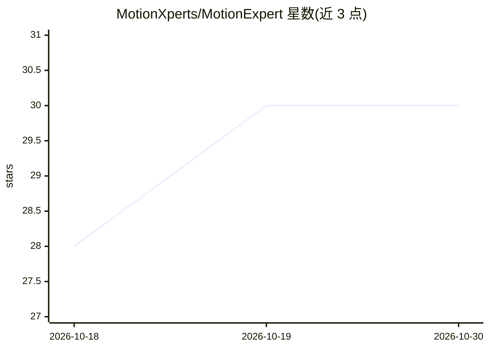

# MotionXperts/MotionExpert

⭐ 30 · Python · Apache-2.0 · 推送 2026-02-27 · [GitHub](https://github.com/MotionXperts/MotionExpert) · [官网](https://motionxperts.github.io/) · 组织维护

**基于运动分析生成体育教练指导语的生成式指令模型（ACL 2025）**

CoachMe 是 ACL 2025 论文的官方实现：基于 3D 骨骼坐标序列（22 关节、66 维特征）与参考动作对比，生成针对花样滑冰跳跃与拳击技术的文本教练指导指令。流程为在 HumanML3D 上预训练，再在 FS/BX 数据集上按 GT/ALIGNED/ERROR 三种设定微调，训练通过 torch.distributed.run 与 YAML 配置文件驱动，训练中断可从上次 epoch 恢复。附带数据集、注意力可视化子模块与 G-eval 评测模板，面向体育动作分析与生成模型研究者。

## 筛选速览

| 维度 | 判定 | 备注 |
|---|---|---|
| AI 角色 | `ai-native` | 本体是模型或模型工具 |
| 许可风险 | `permissive` | Apache-2.0 |
| 部署形态 | `library` | 以包/库形式分发 |
| 模型依赖 | — | README 未给出锁定关系 |
| 硬件要求 | — | 无带数字的原话,不猜 |
| 安装摩擦 | `medium` | 含编译或系统依赖之一 |
| 成熟度 | — | 结构信号不足 |

## 能力要点

- 从 3D 骨骼序列与参考动作对比生成文本教练指导
- 覆盖花样滑冰（4 种跳跃）与拳击（Jab/Cross）数据集
- HumanML3D 预训练 + 多设定（GT/aligned/error）微调
- 训练中断自动从上次 epoch 恢复

## 适用场景

- 复现论文的体育教练指令生成实验
- 基于骨骼坐标数据训练或微调动作指导生成模型
- 研究动作对齐与错误片段检测对指导语生成的影响

## 场景标签

 · 领域:体育动作分析/生成模型

## 证据(README 行号)

> L1: # CoachMe: Decoding Sport Elements with a Reference-Based Coaching Instruction Generation Model (ACL 2025)
> L173: $ gdown 1oDwh8wWRokey6Payds3YdL3IHcCv5lUF -O ./results/skating_gt/pretrain_checkpoints/best_pretrained_weight.pth

## 星数曲线

2026-10-18 28 → 2026-10-30 30（+2）

---
*卡片 v1 · prompt 1.4 · 生成 2026-10-26 · 置信度 high · 依据 README sha `9d9e62d430af` · [字段定义](../../DATASET.md)*
