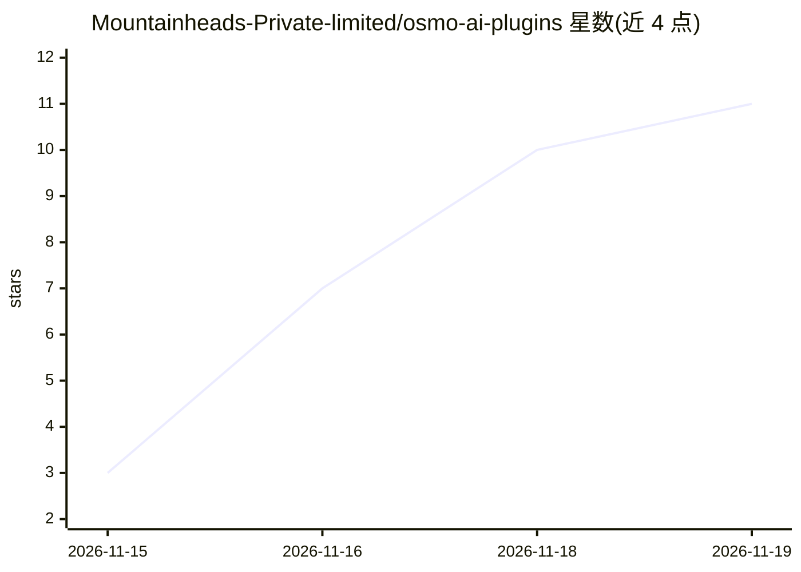

# Mountainheads-Private-limited/osmo-ai-plugins

⭐ 11 · MIT · 推送 2026-11-18 · [GitHub](https://github.com/Mountainheads-Private-limited/osmo-ai-plugins) · [官网](https://getosmo.app/for-my-ai) · 组织维护

**让 ChatGPT/Claude 等 AI 客户端代打电话的 MCP 服务**

OsmO 提供一个托管的 MCP 服务器（https://api.getosmo.app/mcp，Streamable HTTP + OAuth），让用户的 AI 应用代为拨打真实电话并返回结果、摘要与录音转录；同时可作 AI 电话接待员，接听来电、过滤骚扰并记录留言与预订。本机无需安装运行，凭手机号一次性码登录。计费按接听电话扣积分（新用户 50 免费），联系人外拨、预约与接待员功能需 OsmO 移动应用套餐；语音支持英/西/印地语。

## 筛选速览

| 维度 | 判定 | 备注 |
|---|---|---|
| AI 角色 | `ai-ecosystem` | LLM/agent 周边工具 |
| 许可风险 | `permissive` | MIT |
| 部署形态 | `None` |  |
| 模型依赖 | — | README 未给出锁定关系 |
| 硬件要求 | — | 无带数字的原话,不猜 |
| 安装摩擦 | `low` | 无编译、无系统依赖或容器化 |
| 成熟度 | — | 结构信号不足 |

## 能力要点

- 27 个 MCP 工具（place_call/get_call_status 等），工具清单以 tools/list 为准
- 每次呼叫前返回预览并需用户确认，工具声明 readOnlyHint/destructiveHint 等注解
- 支持 ChatGPT、Claude、Cursor、Gemini CLI、Grok、Perplexity 等 MCP 客户端接入
- Claude/ChatGPT 内显示实时呼叫卡片，最多 5 路并发呼叫共享一张卡片

## 适用场景

- 让 AI 替我打电话问药店营业时间或预订餐厅
- 自动致电客服并拿到通话摘要与转录
- 用 AI 接待员接听我的号码、筛选骚扰并记录留言

## 场景标签

`语音 Agent` · 领域:对话与助手

## 证据(README 行号)

> L65: There is nothing to install or run on your machine. Your AI app connects to OsmO's hosted MCP server.
> L70: Every app uses the same server URL: **`https://api.getosmo.app/mcp`** (Streamable HTTP, OAuth).
> L261: Cursor, Codex, Gemini CLI, Grok and others) gets today: 27 tools. ChatGPT is served the release its

## 星数曲线

2026-11-15 3 → 2026-11-19 11（+8）

---
*卡片 v1 · prompt 1.4 · 生成 2026-11-19 · 置信度 high · 依据 README sha `669d36cb8e18` · [字段定义](../../DATASET.md)*
