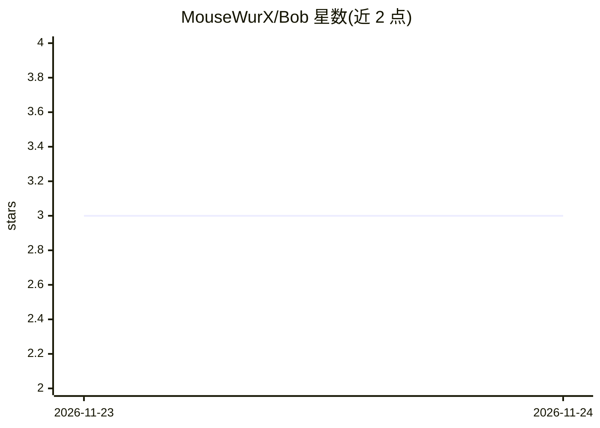

# MouseWurX/Bob

⭐ 3 · JavaScript · GPL-3.0 · 推送 2026-11-24 · [GitHub](https://github.com/MouseWurX/Bob) · [官网](https://github.com/MouseWurX/Bob/releases/latest) · 个人维护

**本地运行的个性化 AI agent，内置模型裁剪实验室**

跨平台桌面/移动应用，用户在本机运行带工具调用、256K 上下文、图像语音与文档处理的 agent；数据默认不出本机，可选功能默认关闭。内置 Computer Science Lab：可在图形界面中对模型做专家裁剪、训练、混合与对比测试；自带基于 llama.cpp 的引擎，支持专家热切换。项目还发布自研裁剪模型、训练数据与成本明细，支持 Bob-Net 在家庭网络中组池共享算力。

## 筛选速览

| 维度 | 判定 | 备注 |
|---|---|---|
| AI 角色 | `ai-native` | 本体是模型或模型工具 |
| 许可风险 | `viral` | GPL-3.0 |
| 部署形态 | `desktop` | 安装包/桌面程序 |
| 模型依赖 | — | README 未给出锁定关系 |
| 硬件要求 | — | 无带数字的原话,不猜 |
| 安装摩擦 | `low` | 无编译、无系统依赖或容器化 |
| 成熟度 | — | 结构信号不足 |

## 能力要点

- 本地运行 agent：研究、代码编写执行、文档/表格读写、图片音乐语音生成
- 256K 上下文（16GB 显卡），可扩至 1M
- Computer Science Lab：图形界面裁剪专家、训练、测试模型，无需命令行
- Bob-Net 在家庭网络或 Tailscale 上组池显卡与内存

## 适用场景

- 在无网络条件下使用本地 AI 助手处理文档与代码
- 在消费级显卡上裁剪和测试自己的模型
- 让多个家用设备的算力组池协作跑任务
- 运行桌面冒险游戏等娱乐场景

## 场景标签

`AI 助手` `图像生成` `微调` · 领域:对话与助手

## 证据(README 行号)

> L3:  A local AI agent with a personality. He runs on your own computer, and nothing goes online unless you turn it on.
> L36: |🧪 **Computer Science Lab**|Cut, teach, mix, race and look inside a brain, then test it next to the one it came fro

## 星数曲线

2026-11-23 3 → 2026-11-24 3（+0）

---
*卡片 v1 · prompt 1.4 · 生成 2026-11-23 · 置信度 high · 依据 README sha `f1af547a8395` · [字段定义](../../DATASET.md)*
