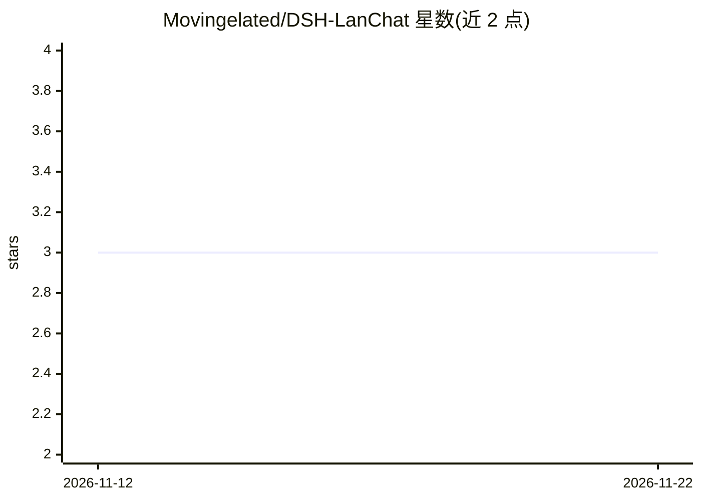

# Movingelated/DSH-LanChat

⭐ — · [GitHub]() · 个人维护 · 中文 README

**局域网消息/文件互传 Windows 工具，带 DSH 插件**

面向同一局域网内的 Windows 机器提供消息与文件互传：单 exe 免安装、零外部依赖，通过 TCP 80（网页/传输）与 UDP 1900（自动发现）通信，传输链路加密但密钥固定编译进 exe。配 DSH（DeepSeek Harness）插件后，AI 可通过 5 个 lanchat_* 工具收发消息与文件，发送侧默认攒批合并（30 秒窗口或 flush），收到消息经防抖与判忙后才自动唤醒本机 AI 会话。另提供无需插件的 HTTP JSON 接口。

## 筛选速览

| 维度 | 判定 | 备注 |
|---|---|---|
| AI 角色 | `ai-enhanced` | 去掉 AI 部分产品仍成立 |
| 许可风险 | `permissive` | — |
| 部署形态 | `desktop` | 安装包/桌面程序 |
| 模型依赖 | locked-api |  |
| 硬件要求 | — | 无带数字的原话,不猜 |
| 安装摩擦 | `low` | 无编译、无系统依赖或容器化 |
| 成熟度 | — | 结构信号不足 |

## 能力要点

- 单 exe 零依赖，托盘常驻，设备间 UDP 自动发现
- DSH 插件提供 5 个 lanchat_* 工具供 AI 调用
- 发送侧合并攒批 + 接收侧唤醒防抖，避免 AI 被拆批唤醒
- 私聊接口层面仅限两台参与机器，另有无插件 HTTP 接口

## 适用场景

- 局域网内几台 Windows 电脑互发消息和文件
- 让多台机器上的 AI 通过局域网互相通讯协作
- AI 发文字加文件时整批送达，避免对面漏看文件

## 场景标签

 · 领域:网络通讯/局域网工具

## 证据(README 行号)

> L3: **同一个局域网内的几台 Windows 电脑之间，互发消息和文件。** 不用服务器、不用注册、不用联网。
> L4: 配一个 DSH（DeepSeek Harness）插件后，**AI 之间也能互相通讯**：AI 能收发消息、传文件，
> L117: > LanChat **完全独立**：关掉 DSH 它照样运行，直到你从托盘点「退出」。

## 星数曲线

2026-11-12 3 → 2026-11-22 3（+0）

---
*卡片 v1 · prompt 1.4 · 生成 2026-11-22 · 置信度 high · 依据 README sha `73304b3ff271` · [字段定义](../../DATASET.md)*
