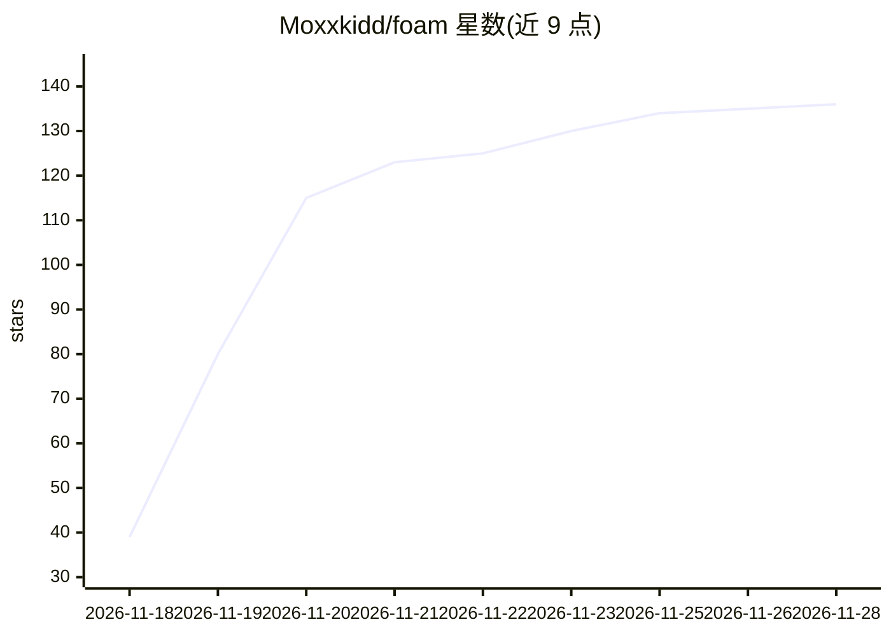

# Moxxkidd/foam

⭐ 136 · Python · GPL-3.0 · 推送 2026-11-26 · [GitHub](https://github.com/Moxxkidd/foam) · 个人维护 · 中文 README

**让 LLM 在 Kali 上自主执行授权渗透测试的 harness**

运行于 Kali Linux 的 Python 工具，让大模型通过 bash 调用系统内任意已装渗透工具，自主规划攻击路径并处理输出。关键机制包括：持久 PTY 会话驱动 msfconsole/ssh 等交互式工具、nmap/sqlmap 等输出解析为原子事实写入 SQLite 索引、scope 护栏逐条校验命令、append-only JSONL 哈希链审计及 replay/verify 只读核验。环境要求 Kali 与 Python ≥ 3.12；protected 网络隔离模式仅支持 root 启动的 Linux，真实 Kali 安装验收明确延期。

## 筛选速览

| 维度 | 判定 | 备注 |
|---|---|---|
| AI 角色 | `ai-native` | 本体是模型或模型工具 |
| 许可风险 | `viral` | GPL-3.0 |
| 部署形态 | `library` | 以包/库形式分发 |
| 模型依赖 | — | README 未给出锁定关系 |
| 硬件要求 | — | 无带数字的原话,不猜 |
| 安装摩擦 | `low` | 无编译、无系统依赖或容器化 |
| 成熟度 | `idea` | |

## 能力要点

- LLM 经 bash 自由调用 Kali 任意已装工具，无需逐工具适配
- 持久 PTY 会话与交互提示识别，支持 msfconsole 等交互工具
- scope 护栏逐命令校验授权范围，越界拒绝并留痕
- 哈希链审计链与 foam replay/verify 只读核验

## 适用场景

- 在授权范围内让模型自主完成靶机渗透并产出报告
- 对渗透过程做哈希链审计与事后重放核验
- 教学与靶场演练中演示模型自主攻击链决策

## 场景标签

`网络安全` · 领域:学习与行业

## 证据(README 行号)

> L3: Kali 原生的 LLM 渗透测试 harness:让大模型直接使用 Kali 的完整工具链,
> L6: 模型自行规划攻击路径、选择并驱动工具、处理输出、管理交互会话;

## 星数曲线

2026-11-18 39 → 2026-11-28 136（+97）

---
*卡片 v1 · prompt 1.4 · 生成 2026-11-28 · 置信度 high · 依据 README sha `e81eed5bbfd6` · [字段定义](../../DATASET.md)*
