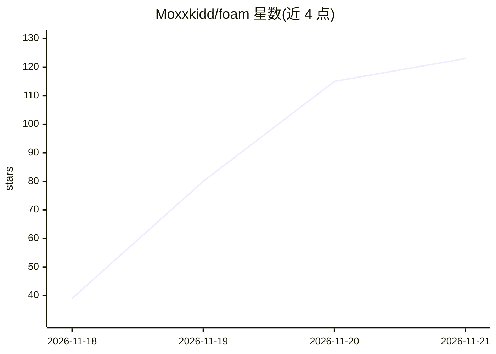

# Moxxkidd/foam

⭐ 123 · Python · GPL-3.0 · 推送 2026-11-13 · [GitHub](https://github.com/Moxxkidd/foam) · 个人维护 · 中文 README

**Kali 上的 LLM 渗透测试 harness：模型自主驱动安全工具链**

运行于 Kali Linux 的 Python 工具，让 LLM 通过 bash 自主使用 Kali 已装工具（nmap/msfconsole/sqlmap 等）完成授权范围内的渗透测试任务：模型自行规划攻击路径、选择工具、处理输出，人只定义 scope 与目标。机制包括持久 PTY 会话与提示识别、工具输出解析写入 SQLite 索引、每条命令的 scope 护栏、append-only 哈希链审计与 replay/verify 只读重放核验。限制：protected 模式的真实 Kali 安装与用户旅程未验收并延期，PTY 会话命令不经过命令级 scope 检查，本地哈希链未外部锚定。仅限书面授权场景。

## 筛选速览

| 维度 | 判定 | 备注 |
|---|---|---|
| AI 角色 | `ai-native` | 本体是模型或模型工具 |
| 许可风险 | `viral` | GPL-3.0 |
| 部署形态 | `library` | 以包/库形式分发 |
| 模型依赖 | locked-api |  |
| 硬件要求 | — | 无带数字的原话,不猜 |
| 安装摩擦 | `low` | 无编译、无系统依赖或容器化 |
| 成熟度 | `idea` | |

## 能力要点

- LLM 经自由 bash 驱动 Kali 任意已装工具，无需逐工具适配
- 持久 PTY 会话支持 msfconsole/ssh/sqlmap 等交互式工具
- scope 护栏 + append-only 哈希链审计，replay/verify 只读重放核验
- nmap/sqlmap/gobuster 等输出自动解析写入 SQLite 索引（hosts/ports/creds/vulns/loot）

## 适用场景

- 在 Juice Shop、Metasploitable2、HTB 等靶场做授权渗透演练
- 让模型自主完成侦察到利用的完整攻击链并留存审计证据
- 渗透测试结项后用 replay/verify 核验审计链与产物完整性

## 场景标签

`网络安全` · 领域:学习与行业

## 证据(README 行号)

> L3: Kali 原生的 LLM 渗透测试 harness:让大模型直接使用 Kali 的完整工具链,
> L6: 模型自行规划攻击路径、选择并驱动工具、处理输出、管理交互会话;
> L27: - **自由 bash + 智能输出层**:LLM 通过 bash 使用 Kali 任意已装工具,

## 星数曲线

2026-11-18 39 → 2026-11-21 123（+84）

---
*卡片 v1 · prompt 1.4 · 生成 2026-11-18 · 置信度 high · 依据 README sha `2a4c8587a9b9` · [字段定义](../../DATASET.md)*
