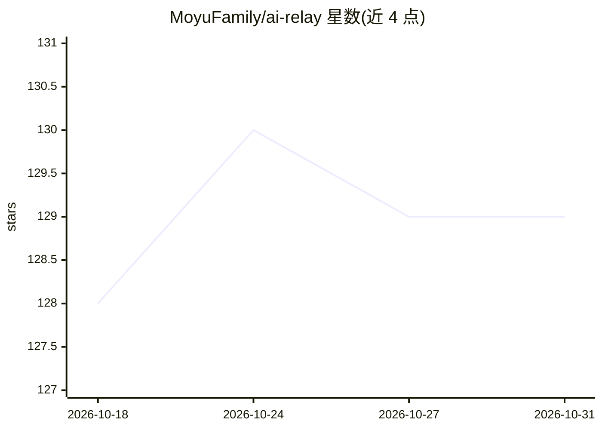

# MoyuFamily/ai-relay

⭐ 129 · TypeScript · MIT · 推送 2026-10-19 · [GitHub](https://github.com/MoyuFamily/ai-relay) · [官网](https://airelay.izmw.me) · 组织维护 · 中文 README

**开源 AI API 网关：多厂商聚合、密钥轮换与故障转移**

将 OpenAI、Claude、DeepSeek、MiMo 及自定义 OpenAI 兼容接口统一在单一端点后的 API 网关，提供多密钥轮换、多级故障转移、熔断与按延迟/成本/可用性的智能路由。兼容 OpenAI SDK（仅改 base_url）与 Anthropic 原生 /v1/messages 端点。部署形态覆盖 Vercel/Cloudflare 免费层、VPS 自托管 Node.js 与本地 CLI（SQLite 记录）。限制：一体化 Docker 镜像与独立 PostgreSQL ConfigStore 仍在开发中，Edge 部署受配额与运行时限制。

## 筛选速览

| 维度 | 判定 | 备注 |
|---|---|---|
| AI 角色 | `ai-ecosystem` | LLM/agent 周边工具 |
| 许可风险 | `permissive` | MIT |
| 部署形态 | `library` | 以包/库形式分发 |
| 模型依赖 | locked-api |  |
| 硬件要求 | — | 无带数字的原话,不猜 |
| 安装摩擦 | `low` | 无编译、无系统依赖或容器化 |
| 成熟度 | `idea` | |

## 能力要点

- 多厂商/多密钥路由：轮换、429 自动退避、故障转移与熔断
- OpenAI 兼容与 Anthropic 原生端点，OpenAI SDK 仅改 base_url
- Vercel 一键部署 / Cloudflare Actions 部署 / VPS / 本地 CLI 四种形态
- Web 管理面板：密钥管理、用量统计、模型别名与 Webhook 告警

## 适用场景

- 把多个 AI 厂商密钥聚合为一个统一端点给应用调用
- 在免费层上零成本搭建个人 AI API 中转
- 本地/内网环境用 CLI 跑私有中转并记录用量

## 场景标签

`模型网关` · 领域:Agent 开发

## 证据(README 行号)

> L3: **Open-source AI API gateway — deploy on your VPS, Vercel, Cloudflare, or locally**
> L24: > Unify OpenAI, Claude, DeepSeek and more behind a single endpoint.
> L60: |**Multi-key, multi-provider**|Automatic rotation, failover, circuit breaking — built-in resilience|

## 星数曲线

2026-10-18 128 → 2026-10-31 129（+1）

---
*卡片 v1 · prompt 1.4 · 生成 2026-10-22 · 置信度 high · 依据 README sha `9a69a8f340fd` · [字段定义](../../DATASET.md)*
