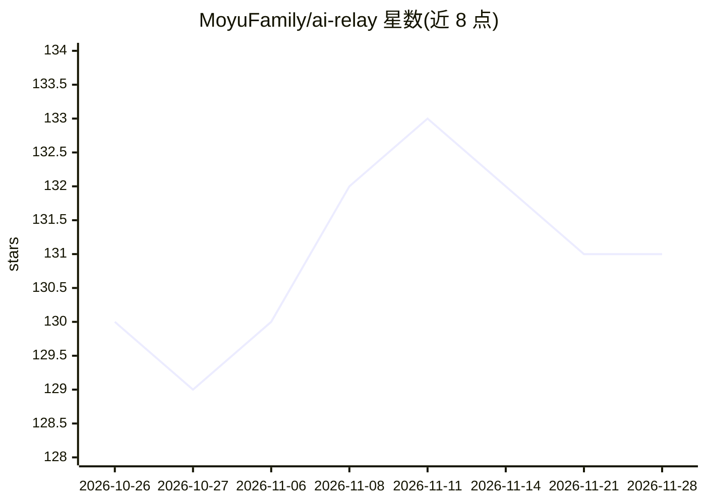

# MoyuFamily/ai-relay

⭐ 131 · TypeScript · MIT · 推送 2026-11-25 · [GitHub](https://github.com/MoyuFamily/ai-relay) · [官网](https://airelay.izmw.me) · 组织维护 · 中文 README

**个人 AI API 网关：聚合多模型提供商到一个端点**

轻量级个人 AI API 网关，将多个上游 LLM 提供商聚合为单一 OpenAI/Anthropic 兼容端点，供各类客户端接入。核心机制：多密钥轮询与 429/5xx 自动冷却、跨提供商故障转移链、熔断与智能路由、模型别名，以及 OpenAI↔Anthropic 双向协议转换。附带可视化管理台（密钥池、用量分析、告警 webhook、备份迁移）。部署方式覆盖 Cloudflare Workers、Vercel、Docker 自托管与本地 CLI。MIT 许可。

## 筛选速览

| 维度 | 判定 | 备注 |
|---|---|---|
| AI 角色 | `ai-ecosystem` | LLM/agent 周边工具 |
| 许可风险 | `permissive` | MIT |
| 部署形态 | `self-host` | docker 或自建部署 |
| 模型依赖 | locked-api |  |
| 硬件要求 | — | 无带数字的原话,不猜 |
| 安装摩擦 | `low` | 无编译、无系统依赖或容器化 |
| 成熟度 | — | 结构信号不足 |

## 能力要点

- 内置 OpenAI、Anthropic、Gemini、DeepSeek、OpenRouter 及任意兼容上游
- 多密钥轮换、跨提供商故障转移、熔断与智能路由
- OpenAI ↔ Anthropic 透明双向协议转换
- 支持 Cloudflare Workers / Vercel / Docker / 本地 CLI 多种部署

## 适用场景

- 将多个 LLM 提供商密钥统一到一个 API 端点
- 为 Claude Code、Codex、Cursor 等客户端配置统一的接入网关
- 在 Serverless 或 VPS 上自托管带密钥轮换与故障转移的转发服务

## 场景标签

`模型网关` · 领域:Agent 开发

## 证据(README 行号)

> L3: **Lightweight personal AI API gateway — one endpoint for all your LLM providers**
> L105: - **One Endpoint for Every Model**: Built-in OpenAI, Anthropic (Claude), Google Gemini, DeepSeek, OpenRouter, and 

## 星数曲线

2026-10-26 130 → 2026-11-28 131（+1）

---
*卡片 v1 · prompt 1.4 · 生成 2026-11-28 · 置信度 mid · 依据 README sha `04ab89bab971` · [字段定义](../../DATASET.md)*
