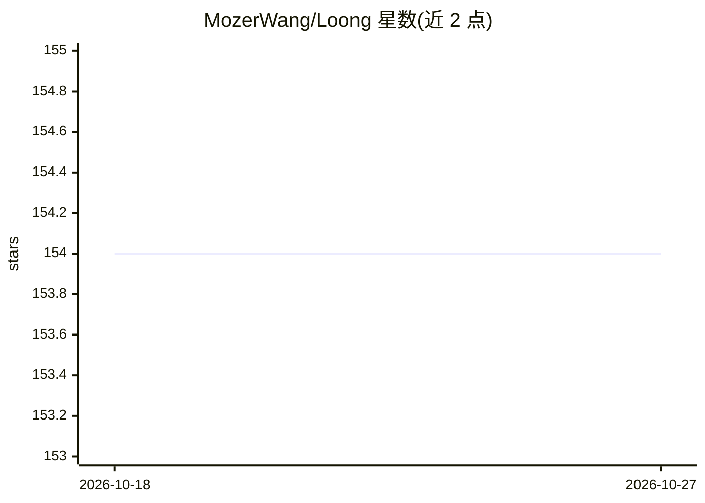

# MozerWang/Loong

⭐ 154 · Python · Apache-2.0 · 推送 2025-12-22 · [GitHub](https://github.com/MozerWang/Loong) · 组织维护 · 中文 README

**长上下文 LLM 评测基准：扩展多文档问答（中英文）**

EMNLP 2024 论文的配套代码与数据集：Loong 基准面向扩展多文档问答场景，每个测试实例平均含 11 篇文档，覆盖英文与中文的财务报告、法律案例、学术论文三类真实语料；设 Spotlight Locating、Comparison、Clustering、Chain of Reasoning 四类任务，输入长度分 10K-50K 至 200K+ 四档。评测流程含数据加载、模型生成、GPT-4 评分与指标统计，开源模型推荐经 vLLM 部署 OpenAI 兼容接口后接入，API 模型用官方接口测试。

## 筛选速览

| 维度 | 判定 | 备注 |
|---|---|---|
| AI 角色 | `ai-ecosystem` | LLM/agent 周边工具 |
| 许可风险 | `permissive` | Apache-2.0 |
| 部署形态 | `library` | 以包/库形式分发 |
| 模型依赖 | local-ok | 支持本地模型 |
| 硬件要求 | — | 无带数字的原话,不猜 |
| 安装摩擦 | `low` | 无编译、无系统依赖或容器化 |
| 成熟度 | — | 结构信号不足 |

## 能力要点

- 平均 11 篇文档/实例的多文档 QA 基准，覆盖财务/法律/学术三类中英语料
- 四类评测任务：Spotlight Locating、Comparison、Clustering、Chain of Reasoning
- 四档输入长度（10K-50K 至 200K+）分长度段报告结果
- GPT-4 作为裁判评分，输出 Avg Scores 与 Perfect Rate 两项指标

## 适用场景

- 评测自家长上下文模型在不同长度段的能力
- 对比候选 LLM 的长文档理解表现
- 复现论文榜单并扩展自有模型的评测流程

## 场景标签

`模型评测` · 领域:评测与运维

## 证据(README 行号)

> L18: This repository contains code for our paper Leave No Document Behind: Benchmarking Long-Context LLMs with Extended 
> L549: - We provide a complete evaluation process:

## 星数曲线

2026-10-18 154 → 2026-10-27 154（+0）

---
*卡片 v1 · prompt 1.4 · 生成 2026-10-22 · 置信度 high · 依据 README sha `3a454bad9057` · [字段定义](../../DATASET.md)*
