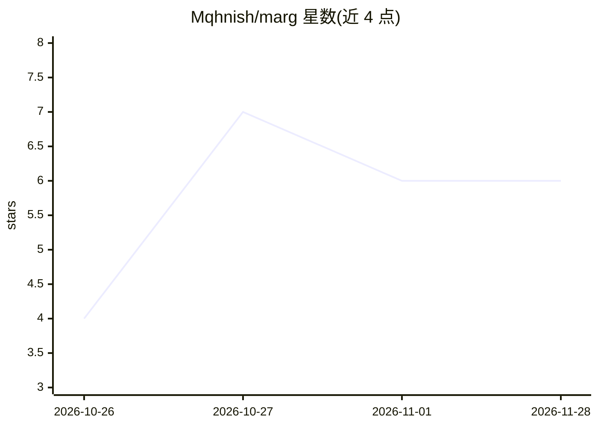

# Mqhnish/marg

⭐ 6 · Python · MIT · 推送 2026-10-22 · [GitHub](https://github.com/Mqhnish/marg) · 个人维护

**读取代码库并生成带引用核验的新人上手指南的 CLI agent**

Marg 是一个命令行 agent：指向一个代码仓库后，通过本地 repo map 加 agent 循环（三个只读工具、步骤预算）阅读代码，生成 ONBOARDING.md，内容包括运行方式、架构图、真实流程走读、入门任务、注意事项与术语表。每条 file:line 引用经核验器检查（文件存在、行号在范围内、agent 确实读过），未通过的在页脚标注。运行于 BharatCode API，支持英语及 12 种印度语言输出（仅正文翻译，代码与引用保持原样）。依赖 API key 才能生成指南；`marg map` 可离线使用。

## 筛选速览

| 维度 | 判定 | 备注 |
|---|---|---|
| AI 角色 | `ai-ecosystem` | LLM/agent 周边工具 |
| 许可风险 | `permissive` | MIT |
| 部署形态 | `self-host` | docker 或自建部署 |
| 模型依赖 | — | README 未给出锁定关系 |
| 硬件要求 | — | 无带数字的原话,不猜 |
| 安装摩擦 | `low` | 无编译、无系统依赖或容器化 |
| 成熟度 | — | 结构信号不足 |

## 能力要点

- 每条 file:line 引用经核验器检查并在指南页脚标注结果
- 三个只读工具与步骤预算约束的 agent 循环，沙箱限定在仓库根目录
- 支持 12 种印度语言输出，代码与引用保持原样
- 发送前对常见 token 格式做脱敏，密钥文件拒绝读取

## 适用场景

- 入职新团队时快速生成代码库上手文档
- 向代码库提问并要求带引用的回答
- 为母语为印度语言的团队成员生成指南

## 场景标签

`编码 Agent` `代码生成` · 领域:编码与开发

## 证据(README 行号)

> L5: Marg (मार्ग, "path") is a command line agent that explores a codebase the way a senior engineer would on day one, th
> L7: It runs on the BharatCode model API, has zero dependencies, and never writes to your repo except for the guide.

## 星数曲线

2026-10-26 4 → 2026-11-28 6（+2）

---
*卡片 v1 · prompt 1.4 · 生成 2026-11-20 · 置信度 mid · 依据 README sha `9352001f6ac0` · [字段定义](../../DATASET.md)*
