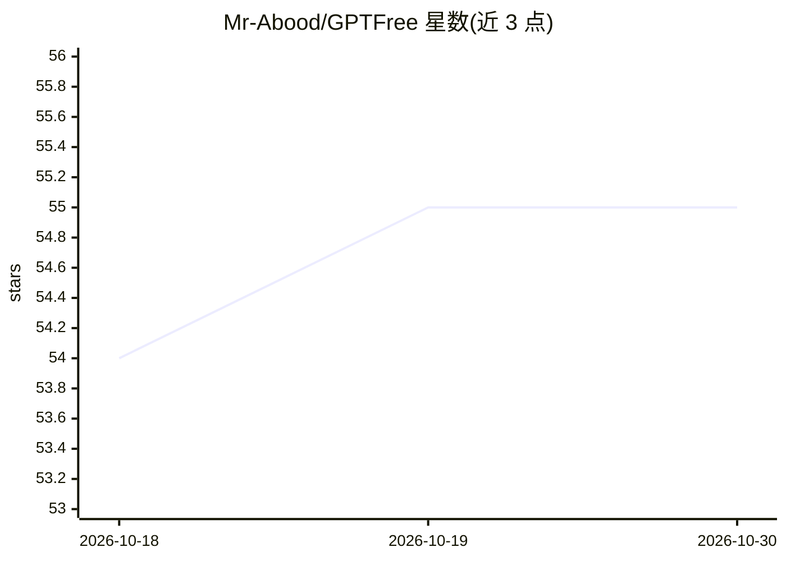

# Mr-Abood/GPTFree

⭐ 55 · 推送 2025-12-07 · [GitHub](https://github.com/Mr-Abood/GPTFree) · [官网](https://algion.dev/) · 个人维护

**免费 OpenAI 兼容 API 服务：免注册获取密钥调用多家模型**

Algion 是一个托管的 OpenAI 兼容 API 服务：用户通过 Telegram 机器人免费获取个人 API Key，将 Base URL 指向 api.algion.dev/v1 即可用官方 openai 客户端库调用，模型列表涵盖 GPT、Claude、Gemini、Grok 系列。支持 /v1/chat/completions 与 /v1/models 端点，自称无严格速率限制。项目自述处于 Beta 阶段，声明不保证可用性，不建议直接用于生产。仓库不提供服务端代码部署途径，仅提供客户端接入说明。

## 筛选速览

| 维度 | 判定 | 备注 |
|---|---|---|
| AI 角色 | `ai-ecosystem` | LLM/agent 周边工具 |
| 许可风险 | `none` | — |
| 部署形态 | `library` | 以包/库形式分发 |
| 模型依赖 | — | README 未给出锁定关系 |
| 硬件要求 | — | 无带数字的原话,不猜 |
| 安装摩擦 | `low` | 无编译、无系统依赖或容器化 |
| 成熟度 | `idea` | |

## 能力要点

- OpenAI 兼容端点，官方客户端库可直接接入
- 经 Telegram 机器人免费发放个人 API Key
- 模型列表覆盖 GPT/Claude/Gemini/Grok 系列

## 适用场景

- 零成本试用多家厂商的对话模型
- 现有 OpenAI SDK 项目切换 Base URL 即可调用
- 个人开发与原型验证场景接入 LLM

## 场景标签

`模型网关` · 领域:Agent 开发

## 证据(README 行号)

> L7: Algion provides a free alternative to OpenAI's API, offering access to advanced AI models without any cost. Our API 
> L78: - ✅ **OpenAI Compatible** - Drop-in replacement for OpenAI API
> L87: - `POST /v1/chat/completions` - Chat completions

## 星数曲线

2026-10-18 54 → 2026-10-30 55（+1）

---
*卡片 v1 · prompt 1.4 · 生成 2026-10-24 · 置信度 mid · 依据 README sha `da1ef34d1921` · [字段定义](../../DATASET.md)*
