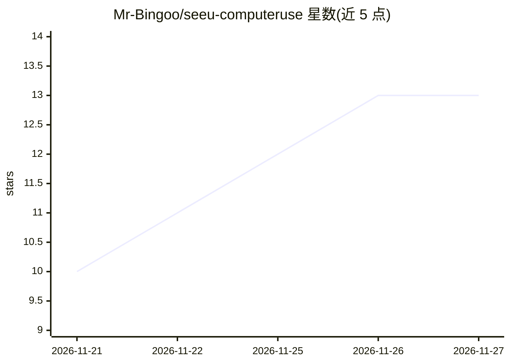

# Mr-Bingoo/seeu-computeruse

⭐ 13 · Python · MIT · 推送 2026-11-26 · [GitHub](https://github.com/Mr-Bingoo/seeu-computeruse) · 个人维护 · 中文 README

**让 AI 在 Mac/Windows/Linux 后台看屏、点击、打字的计算机操作工具**

SeeU（Computer Use 谐音）以代理鼠标和悬浮窗的形式，让接入的 AI 在后台读取界面按钮与文字、按编号点击、后台打字和滚动，不抢占用户的真鼠标与前台窗口；对模拟器等自绘界面改用截图识别。支持 MCP 与 Skill 两种接入方式，一条命令接入 Claude、Codex、Cursor 等客户端；安全底线（不碰终端/密码框、不提交表单）写在代码里。Mac 需 Apple 芯片，Windows/Linux 为预览版，Linux 仅支持 GNOME（Wayland）。

## 筛选速览

| 维度 | 判定 | 备注 |
|---|---|---|
| AI 角色 | `ai-ecosystem` | LLM/agent 周边工具 |
| 许可风险 | `permissive` | MIT |
| 部署形态 | `library` | 以包/库形式分发 |
| 模型依赖 | — | README 未给出锁定关系 |
| 硬件要求 | — | 无带数字的原话,不猜 |
| 安装摩擦 | `low` | 无编译、无系统依赖或容器化 |
| 成熟度 | `idea` | |

## 能力要点

- 紫色代理鼠标与悬浮窗实时显示 AI 操作，不抢鼠标、不切前台
- 一条命令接入 Claude/Codex/Cursor/Trae/VS Code，其他 MCP 客户端经 STDIO 连接
- 安全底线写死在代码：不碰终端、密码框、钥匙串，不替用户提交表单
- 动作未生效会重试或停下说明卡点，后台做不到时先提示再借用鼠标

## 适用场景

- 让 AI 在备忘录、记事本等原生 App 里后台新建和整理内容
- 后台标签页读网页、填表、点按钮，同时自己继续用电脑
- 盯着 VS Code 里的测试用例跑出结果并汇报
- 用 iPhone 镜像在后台操作手机 App（仅 Mac）

## 场景标签

`GUI 自动化` · 领域:效率与自动化

## 证据(README 行号)

> L110: python3 -m seeu install auto      # 或指定:claude | codex | cursor | trae | vscode
> L128: - WorkBuddy、豆包 : 在它们自己的界面里新建一个自定义连接器(本机 / STDIO)，把 `python3 -m seeu mcp` 填进去；其他支持 MCP 的客户端也是这个办法。
> L181: 7. **轻松上手不挑剔** : 一键接入，支持 MCP 和技能(Skill)，不绑定某家客户端。

## 星数曲线

2026-11-21 10 → 2026-11-27 13（+3）

---
*卡片 v1 · prompt 1.4 · 生成 2026-11-21 · 置信度 mid · 依据 README sha `bf0de3ef0332` · [字段定义](../../DATASET.md)*
