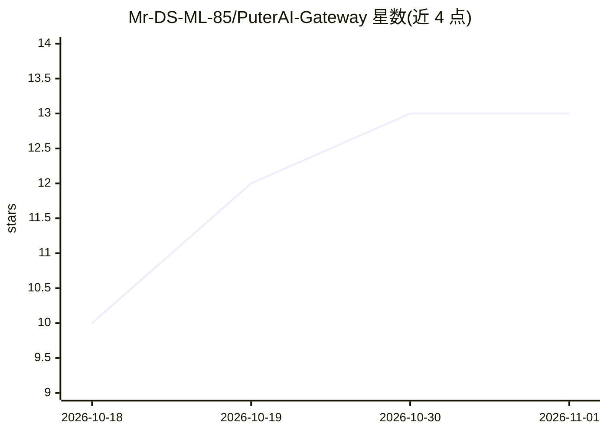

# Mr-DS-ML-85/PuterAI-Gateway

⭐ 13 · HTML · MIT · 推送 2026-10-14 · [GitHub](https://github.com/Mr-DS-ML-85/PuterAI-Gateway) · [官网](http://putergatewayai.devforge.qzz.io/) · 个人维护

**通过浏览器 Puter.js 免 API key 调用五个前沿模型的 OpenAI 兼容网关**

基于 Python FastAPI 的本地 API 网关：对外提供 OpenAI 兼容的 /v1/chat/completions 端点与 SSE 流式响应，可被任意 OpenAI SDK 客户端通过修改 base_url 接入；对内借助在真实浏览器标签页中打开的 bridge 页面轮询队列，调用 Puter.js 的免费 AI（需免费 Puter 账号登录并保持标签页开启）转发至 GPT-5.5 Pro、Claude Opus 4.7、Gemini 3.1 Pro/Flash、DeepSeek V4，全程无需服务端 API key。附 /chat 网页界面与文件上传。README 声明 Puter 免费层存在未公开的按账号每日限额（约 100 次请求），支持多账号轮换以延长用量。

## 筛选速览

| 维度 | 判定 | 备注 |
|---|---|---|
| AI 角色 | `ai-ecosystem` | LLM/agent 周边工具 |
| 许可风险 | `permissive` | MIT |
| 部署形态 | `None` |  |
| 模型依赖 | — | README 未给出锁定关系 |
| 硬件要求 | — | 无带数字的原话,不猜 |
| 安装摩擦 | `low` | 无编译、无系统依赖或容器化 |
| 成熟度 | — | 结构信号不足 |

## 能力要点

- OpenAI 兼容端点，OpenAI SDK 改 base_url 即可接入
- 经浏览器内 Puter.js 调用五个模型，无需服务端 API key
- SSE 流式响应与 /chat 网页界面、文件上传
- 多账号轮换功能用于延长免费额度

## 适用场景

- 已有 OpenAI SDK 客户端想免 API key 试用多个前沿模型
- 本地搭建统一入口转发 Puter.js 免费模型调用
- 通过自带 /chat 页面直接对话和上传文件

## 场景标签

`模型网关` · 领域:Agent 开发

## 证据(README 行号)

> L5: A zero‑configuration API gateway that uses Puter.js to provide OpenAI‑compatible endpoints for five frontier AI mode
> L94: |POST|`/v1/chat/completions`|Chat completion (OpenAI‑compatible)|
> L137: 1. Your app sends a request to `/v1/chat/completions`

## 星数曲线

2026-10-18 10 → 2026-11-01 13（+3）

---
*卡片 v1 · prompt 1.4 · 生成 2026-10-31 · 置信度 high · 依据 README sha `6dbd0719a52b` · [字段定义](../../DATASET.md)*
