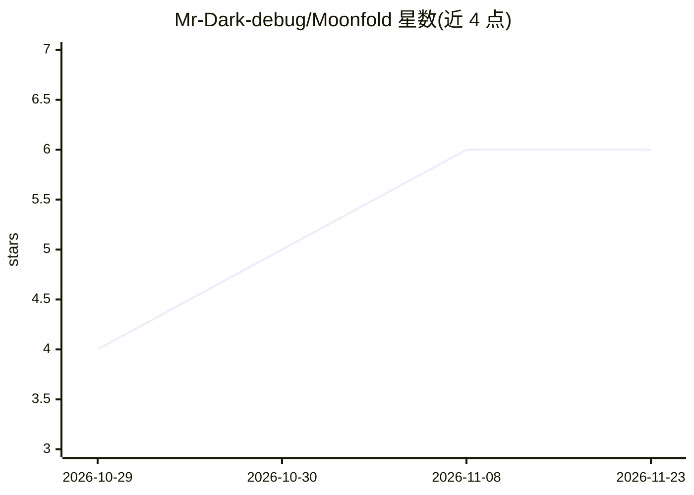

# Mr-Dark-debug/Moonfold

⭐ 6 · TypeScript · MIT · 推送 2026-11-13 · [GitHub](https://github.com/Mr-Dark-debug/Moonfold) · [官网](https://moonfold-website.vercel.app/) · 个人维护

**给开发者统一管理多个编码 agent 的桌面工作台**

开源工作台，将 Codex、Claude Code、Cursor、Grok Build、OpenCode 等编码 agent CLI 以用户自己的账号在本机运行，提供统一桌面/浏览器界面：项目、并行线程、git worktree、diff 审查、PR、定时任务与远程访问。核心机制是 provider handoff：一个 agent 触发用量上限时，生成脱敏任务简报并携计划、diff、待解决问题移交另一 agent 继续。为 T3 Code 的 fork，保持 MIT 许可，本地优先、默认不收集用量数据。安装包未签名，处于 beta 阶段。

## 筛选速览

| 维度 | 判定 | 备注 |
|---|---|---|
| AI 角色 | `ai-ecosystem` | LLM/agent 周边工具 |
| 许可风险 | `permissive` | MIT |
| 部署形态 | `desktop` | 安装包/桌面程序 |
| 模型依赖 | local-ok | 支持本地模型 |
| 硬件要求 | — | 无带数字的原话,不猜 |
| 安装摩擦 | `low` | 无编译、无系统依赖或容器化 |
| 成熟度 | `idea` | |

## 能力要点

- 用量上限时跨 agent 移交任务，携带计划/diff/失败命令的脱敏简报
- 以用户自身登录运行各 agent CLI，不代理、池化或存储 provider 账号
- 桌面与浏览器双界面，支持 git worktree 并行线程、diff 审查与定时任务
- provider matrix 由真实安装上的检查记录生成

## 适用场景

- 一个编码 agent 用量中断时，把任务移交另一个 agent 继续执行
- 在统一界面管理多个厂商 agent 的并行开发任务与 PR 流程
- 从另一台设备或 Android 手机远程访问本机 agent 会话

## 场景标签

`编码 Agent` `代码审查` · 领域:编码与开发

## 证据(README 行号)

> L12: Moonfold is an open-source workspace for the coding agents you already use. It runs Codex,
> L17: The goal that sets Moonfold apart is **provider handoff**: when one agent hits its usage limit

## 星数曲线

2026-10-29 4 → 2026-11-23 6（+2）

---
*卡片 v1 · prompt 1.4 · 生成 2026-11-21 · 置信度 high · 依据 README sha `0259e2882796` · [字段定义](../../DATASET.md)*
