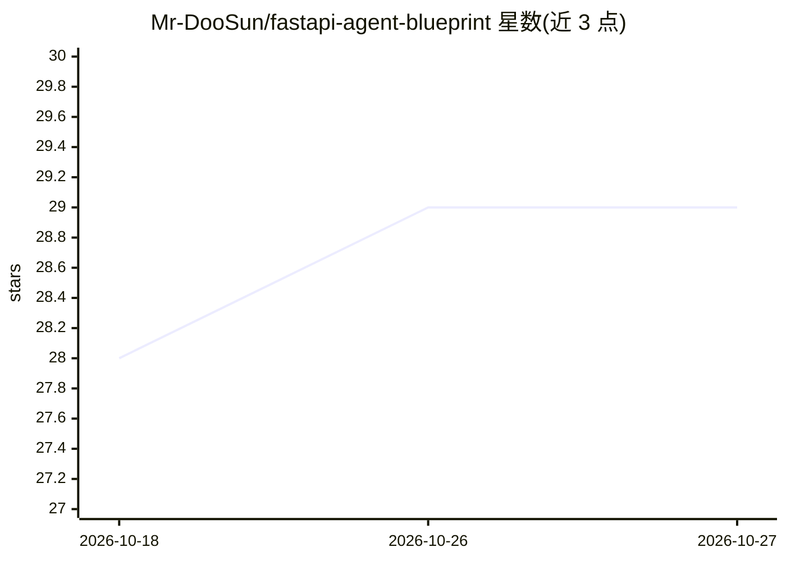

# Mr-DooSun/fastapi-agent-blueprint

⭐ 29 · Python · MIT · 推送 2026-10-12 · [GitHub](https://github.com/Mr-DooSun/fastapi-agent-blueprint) · 个人维护 · 中文 README

**面向 AI 编码代理协作的 FastAPI 后端蓝图模板**

为使用 AI 编码工具的团队提供的 FastAPI 后端起点模板：后端部分包含 DDD 四层域结构（Interface/Domain/Infrastructure/Application）、Router→Service→Repository 运行时路径、Taskiq 后台任务、NiceGUI 管理界面、JWT/RBAC、可选基础设施适配器（SQL/DynamoDB/对象存储/向量存储/AI 提供方），以及含文档问答的 RAG 流水线示例（默认使用关键词 stub 嵌入器与模板化 stub 回答代理，不调用外部模型；安装 pydantic-ai extra 并配置 provider 后可调用真实模型）。协作部分提供跨 Claude Code、Codex、Antigravity 的共享规则（AGENTS.md）、任务技能、计划/执行分离工作流与 CI 检查。本地运行需 Python>=3.12.9、uv、Git、make，无需 Docker/PostgreSQL/云凭证/AI 工具。MCP server 接口为规划中，尚未包含在可运行后端内。

## 筛选速览

| 维度 | 判定 | 备注 |
|---|---|---|
| AI 角色 | `ai-ecosystem` | LLM/agent 周边工具 |
| 许可风险 | `permissive` | MIT |
| 部署形态 | `None` |  |
| 模型依赖 | — | README 未给出锁定关系 |
| 硬件要求 | — | 无带数字的原话,不猜 |
| 安装摩擦 | `low` | 无编译、无系统依赖或容器化 |
| 成熟度 | — | 结构信号不足 |

## 能力要点

- DDD 分层域结构（Router→Service→Repository）+ Taskiq 后台任务 + NiceGUI 管理界面
- 含文档上传/分块/嵌入/检索/带引用回答的可复用 RAG 流水线，默认 stub 模式无外部模型调用
- 跨 Claude Code、Codex、Antigravity 的协作 harness：共享规则、任务技能、计划/执行分离工作流
- 默认 SQLite + InMemory 启动，可选 SQL/DynamoDB/对象存储/向量存储/AI 适配器

## 适用场景

- 团队以 AI 编码代理协作开发多业务域后端时作为统一起点
- 复用其 RAG 流水线快速搭建带引用的文档问答域
- 为团队成员的 AI 编码工具统一架构规则与评审流程

## 场景标签

`RAG` · 领域:知识与检索

## 证据(README 行号)

> L12:  A FastAPI backend blueprint for teams building with AI coding agents.
> L26: |Domain logic shared by HTTP APIs, background tasks, and an admin UI. Optional AI and infrastructure adapters let y
> L92: |Optional infrastructure|SQL databases, DynamoDB, object storage, vector storage, and AI providers behind adapters 

## 星数曲线

2026-10-18 28 → 2026-10-27 29（+1）

---
*卡片 v1 · prompt 1.4 · 生成 2026-10-26 · 置信度 high · 依据 README sha `8bfff175aa1b` · [字段定义](../../DATASET.md)*
