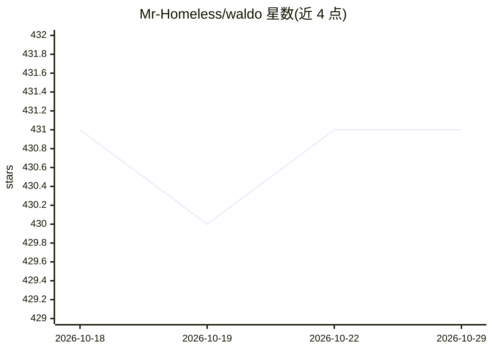

# Mr-Homeless/waldo

⭐ 431 · Python · 推送 2026-02-20 · [GitHub](https://github.com/Mr-Homeless/waldo) · [官网](https://waldo.vision/) · 个人维护

**本地分析 CS2 游戏录像、检测作弊行为的视觉深度学习工具**

面向 CS2 玩家与社区的反作弊分析系统：基于 10 亿参数 Vision Transformer（VideoMAE v2）分析游戏录像。流程为：通过音频识别击杀瞬间自动截取 2 秒片段，用户本地标注并训练/微调模型（需至少 48 个片段），再对片段输出 0.0-1.0 的作弊置信度，含逐帧分析、统计图表与 JSON 导出。全本地处理，需 NVIDIA CUDA GPU，通过 WSL/脚本安装，提供 Web 界面（localhost:5000）。当前为 Alpha 版本，需自训模型。

## 筛选速览

| 维度 | 判定 | 备注 |
|---|---|---|
| AI 角色 | `ai-native` | 本体是模型或模型工具 |
| 许可风险 | `none` | — |
| 部署形态 | `None` |  |
| 模型依赖 | — | README 未给出锁定关系 |
| 硬件要求 | — | 无带数字的原话,不猜 |
| 安装摩擦 | `high` | 编译与系统依赖俱全 |
| 成熟度 | `idea` | |

## 能力要点

- 音频检测击杀并自动截取 2 秒片段
- 本地训练/微调 Vision Transformer 模型并输出作弊置信度
- 逐帧（16 帧）分析与中心十字准星区域裁剪
- 全本地处理，无云端连接

## 适用场景

- 审查可疑玩家的比赛录像并得到置信度参考
- 用自己的标注片段本地训练定制检测模型
- 批量处理录像并导出 JSON 结果用于社区分析

## 场景标签

`图像视频处理` `微调` · 领域:感知与多模态

## 证据(README 行号)

> L3: **Advanced AI-powered cheat detection for Counter-Strike 2 gameplay footage**
> L12: - **Analyzes processed clips** - Provides detailed confidence scores from 0.0 (likely legitimate) to 1.0 (likely ch

## 星数曲线

2026-10-18 431 → 2026-10-29 431（+0）

---
*卡片 v1 · prompt 1.4 · 生成 2026-10-21 · 置信度 high · 依据 README sha `7a2db6ff0254` · [字段定义](../../DATASET.md)*
